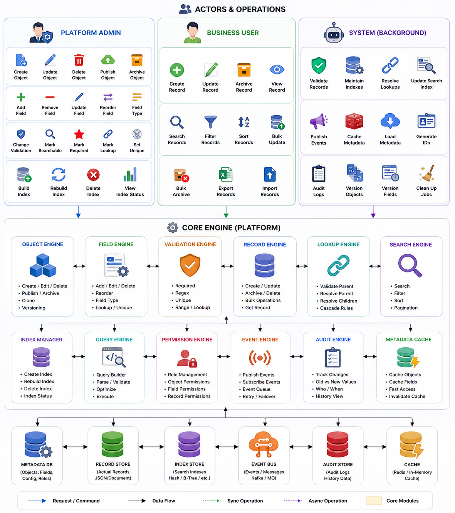
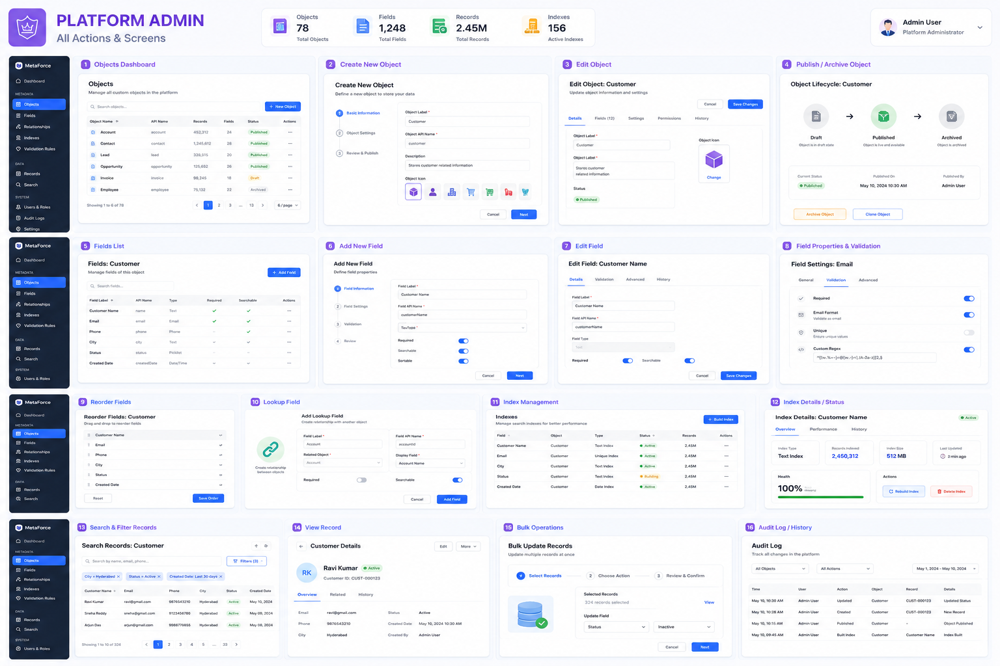
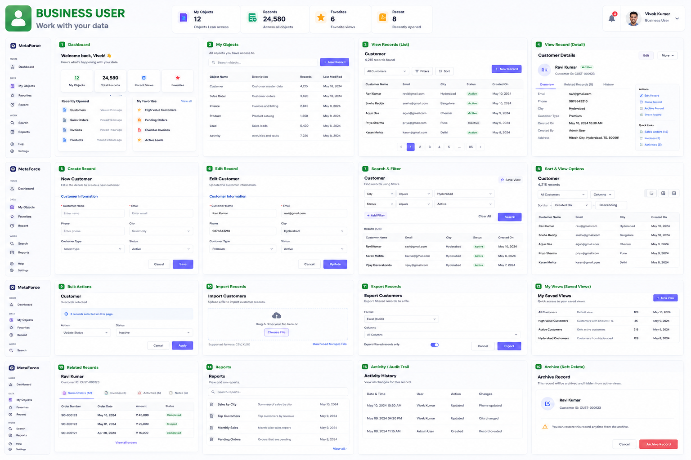
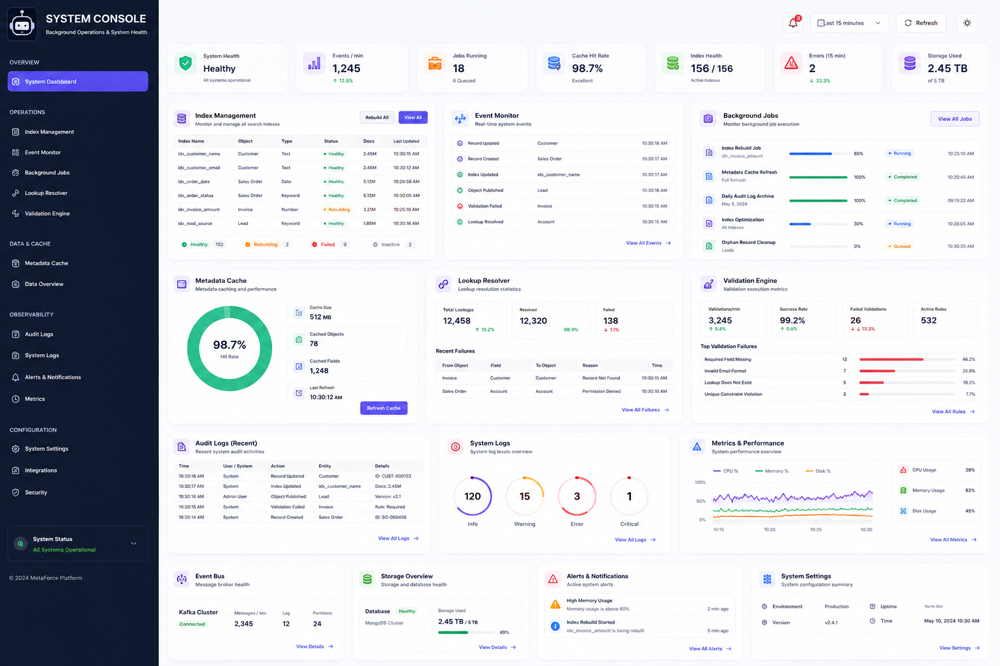

Yes buddy, I know this pattern. It's actually a common architecture used in dynamic form builders, CRMs, ERPs, CMSs, No-Code platforms, metadata-driven systems, and Salesforce-like architectures.

The idea is to separate the schema (structure) from the data (values).

1. Object Master (Schema)

This defines what fields an object has, not the actual data.

Example:

{
  "_id": "customer",
  "name": "Customer",
  "fields": [
    {
      "id": "f1",
      "name": "firstName",
      "type": "string",
      "required": true
    },
    {
      "id": "f2",
      "name": "lastName",
      "type": "string"
    },
    {
      "id": "f3",
      "name": "age",
      "type": "number"
    },
    {
      "id": "f4",
      "name": "email",
      "type": "email"
    }
  ]
}

Think of it as

Customer Object

First Name
Last Name
Age
Email

It only defines the columns.

2. Record JSON Master (Actual Values)

Now every customer stores only the values.

Example

{
    "_id":"rec1",
    "objectId":"customer",
    "recordJson":{
        "f1":"Vivek",
        "f2":"Thumu",
        "f3":24,
        "f4":"vivek@gmail.com"
    }
}

Another customer

{
    "_id":"rec2",
    "objectId":"customer",
    "recordJson":{
        "f1":"Rahul",
        "f2":"Sharma",
        "f3":27,
        "f4":"rahul@gmail.com"
    }
}

Notice that the values are stored against the field IDs.

Why field IDs instead of names?

Suppose later you rename

firstName

to

Given Name

If records stored

{
    "firstName":"Vivek"
}

then millions of records would need updating.

Instead,

Object Master changes

{
    "id":"f1",
    "displayName":"Given Name"
}

The record remains

{
    "f1":"Vivek"
}

Zero record updates.

Relationship
                Object Master

        Customer
        --------------------
        f1 -> First Name
        f2 -> Last Name
        f3 -> Age
        f4 -> Email


                 │
                 │
                 ▼


         Record JSON Master

Record 1
{
   f1 : Vivek
   f2 : Thumu
   f3 : 24
   f4 : vivek@gmail.com
}

Record 2
{
   f1 : Rahul
   f2 : Sharma
   f3 : 27
   f4 : rahul@gmail.com
}
Rendering Flow

When UI opens a record:

Load Object Master
        │
        ▼
Know all fields

        │
        ▼
Load Record JSON

        │
        ▼
Map

f1 → First Name
f2 → Last Name
f3 → Age
f4 → Email

        │
        ▼
Render Form

The UI combines the schema with the values.

Advantages
Dynamic objects (create new objects without changing code)
Dynamic fields
Dynamic forms
Easy field rename
Validation driven by metadata
Role-based permissions per field
Search configuration
Reporting
Workflows
API generation
Versioning

This is why platforms like Salesforce, Zoho Creator, Airtable, and many internal enterprise platforms use metadata-driven designs.

Typical Database Design
ObjectMaster
------------
_id
name
description

FieldMaster
-----------
_id
objectId
fieldName
displayName
type
required
defaultValue
validation
order

RecordMaster
------------
_id
objectId
recordJson
createdBy
updatedBy
createdAt
updatedAt

where recordJson looks like:

{
    "f1":"Vivek",
    "f2":"Thumu",
    "f3":24,
    "f4":"vivek@gmail.com"
}

This architecture is extremely scalable because the schema (Object + Field Masters) and the data (Record JSON Master) evolve independently. You can add new fields, rename existing ones, change validation rules, or build entirely new object types without altering the underlying database schema—only the metadata changes. It's one of the foundational patterns behind configurable enterprise applications and no-code platforms.


Exactly buddy. 👍 You're now entering one of the most important parts of metadata-driven architectures: relationships (lookups).

Just like in a relational database where you have foreign keys, in an Object Master architecture you have Lookup Fields.

Example

Suppose we have two objects.

Class
------
Class Name
Section
Teacher

Student
--------
Name
Age
Roll Number
Class (Lookup)

The "Class" field inside Student is actually a lookup to the Class object.

Object Master
Class Object
Object
-------
objectId = class

Fields

f1 -> Class Name
f2 -> Section
f3 -> Teacher
Student Object
Object
-------
objectId = student

Fields

f10 -> Name
f11 -> Age
f12 -> Roll No
f13 -> Class (Lookup)

Notice

f13

isn't a normal String.

Instead

{
    "fieldId":"f13",
    "name":"Class",
    "type":"LOOKUP",
    "lookupObject":"class"
}

So this field knows

"I don't store text. I point to another object's record."

Record JSON

Class Record

{
    "_id":"class_101",
    "objectId":"class",
    "recordJson":{
        "f1":"10th",
        "f2":"A",
        "f3":"Mr John"
    }
}

Student Record

{
    "_id":"student_1",
    "objectId":"student",
    "recordJson":{
        "f10":"Vivek",
        "f11":24,
        "f12":101,
        "f13":"class_101"
    }
}

See?

Instead of storing

10th A

it stores

class_101

Exactly like a foreign key.

Forward Lookup

Student

Student
-------
Name
Age
Class ---> class_101

means

Student
     │
     ▼
Class

This is called the forward relationship because Student explicitly stores the reference.

Backward Lookup

Suppose you're on the Class page.

You want

Class

Students

• Vivek
• Rahul
• Arjun
• Sai

But the Class object stores nothing about students.

Instead

Student
-------
class = class_101

So you query

Find all Student records

WHERE

class = class_101

This is the reverse (backward) lookup.

No extra data is stored in Class.

Visualization
                Class

         class_101
         ----------
         10th
         A

             ▲
             │
             │
   ------------------------
   │          │          │
Student1   Student2   Student3

class=101 class=101 class=101

Forward

Student
   │
   ▼
Class

Backward

Class
   │
Find all Students
Why don't we store students inside Class?

Imagine

Class

Students
[
student1,
student2,
student3,
...
]

Now a new student joins.

You'd have to

Update Student
Update Class

Two writes.

Instead

Just create

Student

class = class_101

Done.

The reverse relationship is computed when needed.

Metadata for Lookup

A lookup field might look like

{
    "fieldId":"f13",
    "fieldName":"Class",
    "type":"LOOKUP",
    "lookupObject":"class",
    "displayField":"f1"
}

So the UI knows:

Save the referenced record ID (class_101)
Display the class name (using f1, e.g. "10th")
Multiple Relationship Types

You can model several common relationships:

One-to-One
-----------
Employee ---> Passport

One-to-Many
-----------
Class ---> Students

Many-to-One
-----------
Student ---> Class

Many-to-Many
------------
Student <----> Subject

For many-to-many, you typically introduce a junction object, for example:

StudentSubject

studentId
subjectId

rather than storing arrays of IDs in either object. This keeps the model consistent and scales much better.

One suggestion for your architecture

I would avoid calling them "forward lookup" and "backward lookup" internally. Those names are intuitive, but in system design it's more common to think of them as:

Reference (Lookup) Relationship → the field that stores another record's ID.
Reverse Relationship → a computed view that finds all records pointing back to the current record.

This matches how enterprise systems (Salesforce, Dynamics, ServiceNow, etc.) typically model relationships. The reverse relationship usually isn't stored as data; it's derived by querying records that reference the current one.

From what you've described so far, you're essentially designing a metadata-driven platform where Objects define schemas, Fields define metadata, Records hold values, and Lookups connect records across objects. That's the same core architectural idea behind many enterprise CRM and low-code platforms.


Buddy, this is exactly the kind of question that separates a CRUD developer from a system designer. You're now thinking about how Salesforce, Airtable, HubSpot, Zoho CRM, and Dynamics CRM search billions of records efficiently.

The answer is don't search the JSON directly. Instead, build a search/index layer.

Let's build it step by step.

Your Current Architecture
Object Master
-------------
Customer

Fields
------
f10 -> Name
f11 -> Age
f12 -> City
f13 -> Email

Record
-------

{
   recordId : 101,
   objectId : Customer,
   recordJson:{
       f10:"Vivek",
       f11:24,
       f12:"Hyderabad",
       f13:"abc@gmail.com"
   }
}

Suppose customer clicks

City = Hyderabad

Age > 20

Name StartsWith Vi

Now imagine

50 Million records

If you read

recordJson

↓

Parse JSON

↓

Compare

↓

Next Record

↓

Next Record

That is a full table scan.

Very slow.

Why is JSON Searching Slow?

Suppose MongoDB stores

recordJson

as

{
f10:...
f11:...
f12:...
...
}

Without indexes,

Searching

City = Hyderabad

means

Read Record 1

↓

Read Record 2

↓

Read Record 3

↓

...

↓

50 Million

Complexity

O(N)

Terrible.

Real Enterprise Architecture

They separate

Storage

Search

into two different concerns.

                UI

                 │

                 ▼

        Search Service

                 │

      Uses Search Index

                 │

                 ▼

           Record Store

Notice

Users don't directly search JSON.

They search indexes.

Think Like a Book

Imagine a library.

Would librarian do

Book1

Book2

Book3

Book4

...

Book10000000

to find

Author = James

No.

Instead

There is an

Index

James

↓

Books

4

89

201

9001

Same idea.

Search Index

Instead of

Record JSON

create another structure.

Search Index

Field

Value

RecordId

Example

Customer

Record1

Name = Vivek
City = Hyderabad
Age = 24

Index

Name

Vivek

↓

101
City

Hyderabad

↓

101
↓

190
↓

220
↓

900
Age

24

↓

101
↓

250
↓

800

Now

Searching

City = Hyderabad

becomes

Lookup

↓

Hyderabad

↓

Record IDs

Milliseconds.

Index Structure

Internally

City

Hyderabad

↓

[101,190,220]

Bangalore

↓

[400,500]

Delhi

↓

[900]

Almost like

HashMap

City

↓

Value

↓

Record IDs
What Happens During Writes?

Suppose

Insert

Vivek

Hyderabad

24

Write flow

Client

↓

API

↓

Save Record

↓

Update Search Index

↓

Commit

So

Write

Record Store

AND

Search Index

Both.

This is why writes become slightly slower.

But reads become incredibly fast.

Read Heavy Systems

CRM

ERP

Hospital

College

Salesforce

Zoho

Bank

Most workloads

Reads

>>

Writes

Example

1000 Reads

10 Writes

So

Making writes

5 ms slower

to make reads

500 ms faster

is worth it.

Field Configuration

Not every field should be indexed.

Suppose

Description

5000 characters

Nobody filters by it.

Don't index.

Object Master

f10

Name

indexed=true
f11

Age

indexed=true
f12

Description

indexed=false

Only indexed fields are searchable.

Huge memory savings.

Composite Filters

Customer chooses

City = Hyderabad

AND

Age = 24

Search Engine

City Index

↓

[1,2,5,7]

Age Index

↓

[2,5,9]

Intersection

[2,5]

Only fetch

Record2

Record5

Super fast.

Range Queries

Age

20

↓

[10,20]
21

↓

[9,15]
22

↓

...

For

Age > 20

Use

B Tree

or

Sorted Index

instead of HashMap.

This is why databases use B-Trees.

Text Search

Name

Vivek Kumar

Searching

Viv

HashMap cannot help.

Need

Prefix Tree (Trie)

or

Inverted Index

Search engines like Elasticsearch, Solr, and OpenSearch build specialized text indexes for this.

Enterprise Architecture
                Client

                   │

                   ▼

           Search API

                   │

         Query Builder

                   │

        Search Engine Layer

        │               │

        ▼               ▼

 Search Index      Record Store

Search Index

Fast Lookup

Record Store

Truth
Why Two Databases?

Many companies do

MongoDB

↓

Stores Truth
ElasticSearch

↓

Stores Search Index

Because

Mongo

Good storage

Elastic

Excellent searching

Write Flow
Insert Record

↓

MongoDB

↓

Event

↓

Kafka

↓

Elastic

↓

Indexed

Asynchronous indexing is common because it keeps writes fast and lets the search index catch up shortly after.

Read Flow
User

↓

Search

↓

Elastic

↓

Record IDs

↓

Mongo

↓

Records

↓

Response
Why This Architecture Wins

Instead of

Search JSON

↓

O(N)

You do

Search Index

↓

O(log N)

or

O(1)

↓

Record IDs

↓

Fetch Only Needed Records

With millions of records, that difference is the difference between minutes and milliseconds.

If I were designing your platform

Because you're building a generic metadata-driven platform (Objects → Fields → Records → Lookups), I would introduce a dedicated Index Service rather than embedding search logic into the Record Service.

                 Object Master
                       │
                 Field Metadata
             (searchable, sortable,
               filterable, unique)
                       │
                       ▼
                 Record Service
                  (source of truth)
                       │
             Record Created/Updated
                       │
                 Event Bus (Kafka)
                       │
                       ▼
                  Index Service
                       │
          Builds field-specific indexes
                       │
                       ▼
          Elasticsearch / OpenSearch
                       │
                       ▼
                Search API → UI

This gives you:

Fast reads because queries hit optimized indexes.
Scalable writes because indexing happens asynchronously.
Flexible metadata because each field can declare whether it is searchable, filterable, sortable, or unique.
Independent scaling of the search system and the record storage.

This pattern is used by many large-scale enterprise systems because it cleanly separates the source of truth (your records) from the query-optimized representation (your indexes), allowing both to evolve independently while supporting millions of records and thousands of object types.


Buddy, I actually think this is an excellent system design project, because it demonstrates almost every backend concept companies care about.

But I would slightly change the scope.

Don't try to build "Salesforce". Build the "Metadata Engine" that powers Salesforce.

That is a much cleaner MVP and is still technically impressive.

Think of your product as
MetaDB

"The database behind Salesforce."

Instead of

Salesforce Clone

Because Salesforce has

CRM
Workflows
Reports
Dashboards
Emails
AI
Marketing
Security
Sharing
Communities

Millions of features.

But underneath...

Everything starts from

Objects
↓

Fields

↓

Records

↓

Relationships

↓

Search

That is the core engine.

MVP Goal

Imagine a developer comes to your platform.

He creates

Customer

Adds fields

Name

Age

Email

City

Clicks

Create Object

Done.

Now

Database

↓

Object Created

↓

API Generated

↓

Search Generated

↓

UI Generated

without writing code.

That's incredibly powerful.

MVP Features

I would stop here.

Phase 1

Metadata Engine

✅ Create Object

✅ Edit Object

✅ Delete Object

✅ Add Fields

✅ Field Validation

✅ Lookup Field

✅ Object Versioning
Phase 2

Records

✅ Create Record

✅ Update Record

✅ Delete Record

✅ Bulk Insert

✅ Pagination

✅ Sorting
Phase 3

Search

This is the interesting part.

Object

↓

Searchable Fields

↓

Index Builder

↓

Search API

↓

Result

Search like

City = Hyderabad

AND

Age > 25

AND

Name StartsWith "Vi"

LIMIT 20

Response

under

100 ms

even for millions of records.

Phase 4

Relationships

Customer

↓

Orders

↓

Payments

↓

Invoices

Support

One To One

One To Many

Many To One

Many To Many
Phase 5

Security

Admin

Manager

Employee

Field level

Read

Write

Hidden

Object level

CRUD
Phase 6

AI

Don't start with AI.

Use AI only where it provides real value.

For example

User types

Show all Hyderabad customers older than 25

AI converts it into

City="Hyderabad"

Age>25

Your search engine executes it.

Another example

Import this Excel

AI understands

Column A

↓

Customer Name

Column B

↓

Age

Column C

↓

Email

Auto maps fields.

This is much more useful than "adding AI" everywhere.

The Search Architecture

This is what I would build.

                UI

                 │

                 ▼

           Search API

                 │

          Query Parser

                 │

         Query Optimizer

                 │

          Index Manager

                 │

        ┌────────┴────────┐

        ▼                 ▼

 Secondary Index      Record Store

        │                 │

        └────────┬────────┘

                 ▼

              Response
Indexes

Every searchable field

Name

↓

Hash Index

Every sortable field

Age

↓

B+ Tree

Text fields

Description

↓

Inverted Index

Geo fields

Location

↓

Geo Index

Exactly how databases work.

Metadata

Every field stores metadata.

Name

Type

Indexed

Unique

Sortable

Filterable

Nullable

Default

Lookup

Encrypted

Example

{
    "fieldId":"f10",
    "name":"City",
    "type":"STRING",
    "indexed":true,
    "sortable":true,
    "filterable":true,
    "unique":false
}

Then your engine automatically knows

"I need to build an index for this field."

Search Flow
User

↓

City = Hyderabad

↓

Search API

↓

Read City Index

↓

Record IDs

↓

Read Records

↓

Return JSON

No scanning.

Write Flow
Create Record

↓

Save Record

↓

Publish Event

↓

Index Builder

↓

Update Index

Notice

Searching never rebuilds indexes.

Indexes are maintained continuously.

What Makes This Different?

Most CRUD projects demonstrate:

Controller

↓

Service

↓

Repository

↓

Database

That's good, but common.

Your project would demonstrate:

Metadata Engine

↓

Dynamic Schema

↓

Index Builder

↓

Search Engine

↓

Query Optimizer

↓

Lookup Engine

↓

Permission Engine

That's a much deeper system design project.

AI Features Worth Adding

Rather than trying to build a generic chatbot, focus AI on the platform itself:

Natural language search
"Customers from Hyderabad who joined this month."
Automatic schema generation
"Create an Employee object with payroll fields."
Smart data import
Upload CSV/Excel → AI maps columns to fields.
Formula generation
"Create a Full Name field from First Name + Last Name."
Search explanation
"Why did this record match my filter?"

These features directly enhance the metadata engine.

If I were building this as a portfolio project

I would call it something like:

MetaCore

or

ObjectDB

or

DynamicDB

with the tagline:

"A metadata-driven application platform with dynamic objects, relationships, indexing, and high-performance search."

One piece of advice

Don't optimize for "1 billion records" in your first implementation. Optimize for an architecture that could scale there.

If your MVP cleanly demonstrates:

Dynamic object creation
Metadata-driven schemas
Lookup relationships
Secondary indexing
Query planning
Fast filtering
Event-driven index updates

then you've already built something that showcases advanced system design. Scaling from millions to billions is then largely a matter of distributed infrastructure (partitioning, replication, sharding, caching, distributed search clusters) rather than changing the core architecture itself.

That makes for a much stronger portfolio project than trying to simulate internet-scale data on day one.


Buddy, I think you're approaching this the right way.

Since your goal is to learn LLD (Low-Level Design), don't ask:

"What features does Salesforce have?"

Instead ask:

"Which features force me to design good classes, interfaces, relationships, patterns, and SOLID principles?"

Those are very different goals.

Your Learning Goal

Your MVP should maximize exposure to LLD concepts.

That means every feature should teach one or more of:

SOLID Principles
Design Patterns
Composition vs Inheritance
Factory Pattern
Strategy Pattern
Builder Pattern
Observer Pattern
Repository Pattern
State Pattern
Validation
Extensibility

Don't spend weeks building authentication pages or email notifications. Those don't teach much LLD.

I would define the actors like this
1. Platform Admin

This actor manages the metadata.

Responsibilities

Create Object

Update Object

Delete Object

Publish Object

Archive Object

Manage fields

Add Field

Remove Field

Update Field

Reorder Fields

Change Validation

Mark Searchable

Mark Required

Mark Lookup

Manage indexes

Build Index

Rebuild Index

View Index Status
2. Business User

This actor never edits metadata.

They only use the objects.

Operations

Create Record

Update Record

Delete Record

Search Records

Filter Records

Sort Records

View Record
3. System (Background Actor)

Many beginners forget this actor.

The system itself performs work.

Responsibilities

Maintain Indexes

Validate Records

Resolve Lookups

Publish Events

Update Search Index

This is an important actor because it leads naturally to event-driven thinking.

MVP Modules

Instead of thinking about screens, think in modules.

Module 1 — Object Engine

Purpose

Manage Object Definitions

Operations

Create Object

Update Object

Delete Object

Publish Object

LLD concepts

Factory
Builder
Repository
Aggregate Root
Module 2 — Field Engine

Purpose

Manage Fields

Operations

Add Field

Edit Field

Delete Field

Validate Field

LLD concepts

Strategy Pattern (validation)
Factory Pattern (field creation)
Open/Closed Principle
Module 3 — Record Engine

Purpose

Manage Records

Operations

Insert

Update

Delete

Get

Bulk Insert

LLD concepts

Repository
Unit of Work
Builder
Module 4 — Lookup Engine

Purpose

Resolve Relationships

Operations

Validate Lookup

Resolve Parent

Resolve Children

Cascade Delete

Cascade Update

LLD concepts

Graph traversal
Composition
Dependency management
Module 5 — Search Engine

This is probably the most interesting module.

Operations

Search

Filter

Sort

Pagination

Internally

Create Index

Update Index

Delete Index Entry

Query Index

LLD concepts

Strategy Pattern (different index types)
Factory
Interface Segregation
Dependency Inversion
Module 6 — Validation Engine

Purpose

Required

Min Length

Max Length

Regex

Unique

Lookup Exists

LLD concepts

Strategy Pattern

Example

Validator

↓

RequiredValidator

RegexValidator

UniqueValidator

LookupValidator

NumberValidator

This is a perfect Strategy Pattern exercise.

Module 7 — Query Engine

User writes

Age > 20

City = Hyderabad

Name StartsWith Vi

Engine

Parse

↓

Build Query

↓

Optimize

↓

Execute

LLD concepts

Interpreter Pattern
Composite Pattern
Builder Pattern
Features I Would NOT Build

For an LLD-focused MVP, skip these initially:

❌ Login / Signup

❌ Email

❌ Dashboards

❌ Reports

❌ Workflow Automation

❌ AI

❌ Notifications

❌ File Uploads

❌ Mobile App

❌ Themes

These are valuable in products, but they don't provide as much leverage for learning object-oriented design as the metadata engine itself.

The Features I Would Definitely Build

If I wanted maximum learning, my MVP would include exactly these:

Metadata

✓ Create Object
✓ Update Object
✓ Delete Object

Fields

✓ Create Field
✓ Update Field
✓ Delete Field
✓ Validation Rules
✓ Lookup Field

Records

✓ Create
✓ Update
✓ Delete
✓ Bulk Insert

Search

✓ Search
✓ Filter
✓ Sort
✓ Pagination

Relationships

✓ One-To-Many
✓ Many-To-One

Index

✓ Hash Index
✓ B+ Tree Index (or simulate a sorted index)
✓ Index Manager

Validation

✓ Required
✓ Regex
✓ Unique
✓ Number Range
✓ Lookup Exists

That's already enough to exercise a lot of core design ideas.

Why this MVP is so good for LLD

This project naturally leads to many classic design patterns:

Field Creation
    ↓
Factory Pattern

Validators
    ↓
Strategy Pattern

Index Types
    ↓
Strategy Pattern

Search Query
    ↓
Builder Pattern

Events (Record Updated)
    ↓
Observer Pattern

Repositories
    ↓
Repository Pattern

Metadata Loading
    ↓
Singleton (carefully, where appropriate)

Lookup Resolution
    ↓
Composite / Graph traversal

Record Creation
    ↓
Builder Pattern

You won't be forcing patterns into the design—they'll emerge from the requirements.

My suggested learning roadmap

I would implement the project in this order:

Phase 1
--------
Objects
Fields
Records

Phase 2
--------
Validation Engine
Lookup Engine

Phase 3
--------
Search Engine
Index Manager

Phase 4
--------
Query Engine
Pagination
Sorting

Phase 5
--------
Events
Caching
Transactions

Notice that every phase builds on the previous one and introduces new LLD concepts naturally.

One final suggestion

Since your objective is LLD, whenever you add a requirement, ask yourself:

"Will this requirement force me to introduce a new abstraction, interface, or design pattern?"

If the answer is yes (for example, validators, index strategies, query builders, lookup resolvers), it's a high-value addition.

If the answer is no (for example, changing button colors, adding profile photos, AI chat, or fancy dashboards), postpone it until later.

That way, almost every hour you invest in the MVP will strengthen your understanding of object-oriented design and system design rather than UI or feature polish.


Buddy, I actually love this approach because you're staying focused on the engine, not the product.

One thing I would change is don't think in terms of pages, think in terms of bounded contexts/modules. Every module should own one responsibility.

Your Actors

I would keep only these three.

1. Platform Admin

2. Business User

3. System

That's enough for an MVP.

I also like your idea of no login.

Instead,

Users

--------

Admin

Sales Manager

HR Manager

Employee

Click one.

Now you're logged in.

Perfect.

This removes authentication complexity while still allowing you to demonstrate Role-Based Access Control (RBAC).

I would slightly change the Admin responsibilities

Instead of

Create Object

Update Object

Delete Object

Think

Object Lifecycle

because every object has states.

Draft

↓

Published

↓

Archived

This will teach you the State Pattern later.

Object Module
Create

Edit

Publish

Archive

Clone

Notice

I added

Clone Object

Enterprise systems do this a lot.

Fields

Yours are almost perfect.

I'd add

Field Type

Default Value

Unique

Read Only

So

Add Field

Remove Field

Update Field

Reorder Field

Validation

Searchable

Sortable

Unique

Required

Readonly

Lookup
Business User

Exactly what you wrote.

I'd only rename

Delete Record

to

Archive Record

because most enterprise software performs soft deletes rather than physically removing data.

Business User

Create

Edit

Archive

View

Search

Filter

Sort

Bulk Update

Bulk Delete (Archive)

Bulk operations introduce interesting LLD considerations around transactions and validation.

System Actor

This is where beginners usually miss many responsibilities.

I would expand it.

Validate Records

Maintain Indexes

Resolve Lookups

Publish Events

Cache Metadata

Load Metadata

Generate IDs

Audit Logs

Version Objects

Version Fields

The user never sees these.

But these services make your design richer.

One module I think you're missing
Metadata Cache

Remember.

Every request does this.

Load Object

↓

Load Fields

↓

Validate

↓

Save

Imagine

100 million requests.

Will you hit MongoDB every time?

No.

You'll cache metadata.

Mongo

↓

Metadata Cache

↓

API

That introduces caching without making the MVP overly complex.

Another module
Permission Engine

Business User

tries

Delete Record

Permission Engine checks

Role

↓

Permission

↓

Allowed?

Instead of

if(admin)

everywhere.

Very good LLD exercise.

Validation Engine

Don't hardcode

if(required)

Instead

Validator

↓

Required Validator

Regex Validator

Lookup Validator

Unique Validator

Number Validator

That is a textbook Strategy Pattern.

Search Engine

This should be an independent module.

Not inside Record Service.

Search API

↓

Query Builder

↓

Index Manager

↓

Result

Later

You can plug in

Hash Index

B Tree

Trie

Elastic

without changing Search Service.

That's Dependency Inversion in practice.

Index Manager

This is one thing I would definitely add.

Admin

Build Index

Rebuild Index

Delete Index

Index Status

System

Update Index

Maintain Index

Repair Index

Separate responsibilities.

Query Engine

Suppose user selects

Age > 20

City = Hyderabad

Salary > 50000

Don't let Search Service understand everything.

Instead

Search

↓

Query Builder

↓

Expression Tree

↓

Optimizer

↓

Execute

Excellent LLD.

Lookup Engine

Not just

Resolve Lookup

Also

Validate Parent

Resolve Parent

Resolve Children

Cascade Update

Cascade Delete

Prevent Circular Lookup

Circular references are a nice edge case to think about.

Event Engine

Every action

Record Created

↓

Event
Record Updated

↓

Event
Object Published

↓

Event

Then

Index

Audit

Notification

Analytics

can subscribe.

Very scalable.

Audit Engine

Every enterprise application has this.

Record Updated

↓

Old Value

↓

New Value

↓

User

↓

Time

Later

User clicks

History

Shows

Age

20

↓

25

By Vivek

10:30 AM

Very impressive.

Object Versioning

Suppose

Customer

today

Name

Age

Tomorrow

Name

Age

Email

Old records still exist.

You need versions.

Customer

Version 1

↓

Version 2

↓

Version 3
My MVP Boundary

If I were interviewing at Amazon or Microsoft, this is exactly where I'd stop.

Metadata Engine

✔ Object Lifecycle

✔ Field Lifecycle

✔ Record Lifecycle

✔ Validation Engine

✔ Lookup Engine

✔ Search Engine

✔ Index Manager

✔ Query Builder

✔ Permission Engine

✔ Event Engine

✔ Metadata Cache

✔ Audit Engine

Nothing more.

No dashboards.

No AI.

No workflows.

No reports.

No email.

No mobile.

Because this already demonstrates excellent LLD.

One thing I would postpone

You mentioned:

Build Index

Rebuild Index

As a user action.

For the MVP, I'd actually make this automatic.

When Admin marks

Searchable = true

the system should publish:

FieldMarkedSearchableEvent

Then:

Index Service

↓

Build Index

Automatically.

This demonstrates event-driven design, reduces manual steps, and feels closer to how enterprise systems work.

Finally, here's the advice I wish someone had given me when learning LLD

Don't try to impress with the number of features. Impress with the quality of the design.

For every module, ask yourself these questions:

Does this class have only one responsibility?
Can I add a new field type without modifying existing code?
Can I add a new validator without touching old validators?
Can I replace the search implementation (Hash Index → Elasticsearch) without changing business logic?
Can I replace MongoDB with PostgreSQL by only changing repository implementations?

If the answer to those questions is consistently yes, then you're building the kind of LLD that senior engineers look for.

And one last suggestion: don't write any code until you've drawn the module boundaries and responsibilities. A clear responsibility map will make the class design almost emerge naturally, and you'll learn far more from that process than from jumping straight into implementation.


Good now can you generate the image which showing the flow of the software like which actors have the which operation simply and easy to explain based on the above with minimal text but rich icons for all above operations looking good color ful icon rich




Good awsome now can you generate the image having the screens for actor platform admin covering all above actions please with preimum ui and professional simple modern




Good awsome now can you generate the image having the screens for actor business user   covering all above actions please with preimum ui and professional simple modern 




Good awsome now can you generate the image having the screens for actor system     covering all above actions please with preimum ui and professional simple modern 




sngle file within only a tree structure with file names and function names with , for the backend for MERN  and above mentioned technologies  using best SOLID principles and module based architecture - don't over complicate , keep minimal but best standards as you said design pattern  where it needs so give me backend tree structure best standard ways please 

Buddy, since your goal is LLD + System Design, I would not structure it like a typical MERN CRUD application (controllers/services/models). Instead, I would use a Module-Based (Bounded Context) Architecture with SOLID principles.

The idea is:

Each module owns its domain.
Modules communicate through interfaces/events.
Shared code is minimal.
Every module can evolve independently.
Easy to replace MongoDB, Elasticsearch, Redis, etc.
Backend Tree Structure (MERN - Node.js + Express + MongoDB)
backend/
│
├── src/
│
├── app.js
├── server.js
│
├── config/
│   ├── database.config.js
│   ├── redis.config.js
│   ├── logger.config.js
│   ├── env.config.js
│   └── app.config.js
│
├── routes/
│   ├── index.routes.js
│   ├── object.routes.js
│   ├── field.routes.js
│   ├── record.routes.js
│   ├── search.routes.js
│   ├── lookup.routes.js
│   ├── permission.routes.js
│   └── system.routes.js
│
├── modules/
│
│   ├── object/
│   │   ├── object.controller.js
│   │   ├── object.service.js
│   │   ├── object.repository.js
│   │   ├── object.model.js
│   │   ├── object.validator.js
│   │   ├── object.mapper.js
│   │   └── object.events.js
│   │
│   ├── field/
│   │   ├── field.controller.js
│   │   ├── field.service.js
│   │   ├── field.repository.js
│   │   ├── field.model.js
│   │   ├── field.validator.js
│   │   ├── field.factory.js          // Factory Pattern
│   │   ├── field.strategy.js         // FieldType Strategy
│   │   └── field.events.js
│   │
│   ├── record/
│   │   ├── record.controller.js
│   │   ├── record.service.js
│   │   ├── record.repository.js
│   │   ├── record.model.js
│   │   ├── record.validator.js
│   │   ├── record.builder.js         // Builder Pattern
│   │   ├── record.mapper.js
│   │   └── record.events.js
│   │
│   ├── search/
│   │   ├── search.controller.js
│   │   ├── search.service.js
│   │   ├── query.builder.js          // Builder Pattern
│   │   ├── query.parser.js
│   │   ├── query.optimizer.js
│   │   ├── search.repository.js
│   │   └── search.events.js
│   │
│   ├── index/
│   │   ├── index.service.js
│   │   ├── index.manager.js
│   │   ├── hash.strategy.js          // Strategy Pattern
│   │   ├── btree.strategy.js
│   │   ├── trie.strategy.js
│   │   ├── index.repository.js
│   │   └── index.events.js
│   │
│   ├── lookup/
│   │   ├── lookup.controller.js
│   │   ├── lookup.service.js
│   │   ├── lookup.repository.js
│   │   ├── lookup.validator.js
│   │   └── lookup.events.js
│   │
│   ├── validation/
│   │   ├── validation.service.js
│   │   ├── validation.factory.js
│   │   ├── validators/
│   │   │   ├── required.validator.js
│   │   │   ├── unique.validator.js
│   │   │   ├── regex.validator.js
│   │   │   ├── number.validator.js
│   │   │   ├── date.validator.js
│   │   │   └── lookup.validator.js
│   │   └── validation.events.js
│   │
│   ├── permission/
│   │   ├── permission.controller.js
│   │   ├── permission.service.js
│   │   ├── permission.repository.js
│   │   ├── role.service.js
│   │   └── permission.middleware.js
│   │
│   ├── audit/
│   │   ├── audit.service.js
│   │   ├── audit.repository.js
│   │   └── audit.events.js
│   │
│   ├── cache/
│   │   ├── cache.service.js
│   │   ├── metadata.cache.js
│   │   ├── record.cache.js
│   │   └── cache.events.js
│   │
│   ├── event/
│   │   ├── event.bus.js
│   │   ├── event.publisher.js
│   │   ├── event.subscriber.js
│   │   └── event.registry.js
│   │
│   └── system/
│       ├── system.controller.js
│       ├── system.service.js
│       ├── health.service.js
│       ├── scheduler.service.js
│       └── metrics.service.js
│
├── shared/
│
│   ├── constants/
│   ├── enums/
│   ├── errors/
│   ├── middlewares/
│   │   ├── auth.middleware.js
│   │   ├── permission.middleware.js
│   │   ├── validation.middleware.js
│   │   ├── error.middleware.js
│   │   └── logger.middleware.js
│   │
│   ├── utils/
│   ├── logger/
│   ├── helpers/
│   └── response/
│
├── interfaces/
│   ├── repository.interface.js
│   ├── validator.interface.js
│   ├── index.interface.js
│   ├── cache.interface.js
│   └── event.interface.js
│
└── tests/
    ├── object.test.js
    ├── record.test.js
    ├── search.test.js
    └── validation.test.js
Design Patterns Used
Module	Pattern
Field	Factory + Strategy
Validation	Strategy + Factory
Record	Builder
Search	Builder
Index	Strategy
Event	Observer / Pub-Sub
Repository	Repository Pattern
Permission	Strategy
Cache	Proxy-like abstraction
SOLID Principles
S — Each service has one responsibility (ObjectService, RecordService, SearchService, etc.).
O — Add new field types, validators, or index types by adding new classes rather than modifying existing ones.
L — New validator or index implementations can replace existing ones through shared interfaces.
I — Small focused interfaces (Validator, Index, Repository) instead of one large interface.
D — Services depend on abstractions (interfaces), making implementations replaceable.
My only change from a traditional MERN project

Most MERN projects look like:

Controller
    ↓
Service
    ↓
Model

For your metadata platform, think instead in engines:

Object Engine
Field Engine
Record Engine
Search Engine
Index Engine
Validation Engine
Lookup Engine
Permission Engine
Audit Engine
Cache Engine
Event Engine

Each engine is responsible for one business capability. This aligns well with both LLD and future scalability.

I think this is about the right level of complexity for an MVP: it's modular, follows SOLID, demonstrates several important design patterns, and leaves room to evolve into a production-grade architecture without overwhelming you with unnecessary abstractions.


Good now come to the frontend so you created so many screens for 3 actors right the frontend so for that also I want tree structure in the single file covering all the screens of each actor like above give me folder , file name / function name -- don't over complicate , make simple but follow SOLID principles and use design patterns if needed MERN stack i.e REACT give me tree structure  


Buddy, for the **frontend**, I would follow the same philosophy as the backend.

> **Don't organize by components first. Organize by business modules (actors + domains).**

Most React projects become messy because everything ends up in one `components/` folder. For your metadata platform, it's much cleaner to group screens and related UI by feature.

Below is the structure I'd use for an MVP.

---

```text
frontend/
│
├── src/
│
├── main.jsx
├── App.jsx
│
├── assets/
│   ├── icons/
│   ├── images/
│   └── styles/
│
├── layouts/
│   ├── AdminLayout.jsx              → AdminLayout()
│   ├── BusinessLayout.jsx           → BusinessLayout()
│   ├── SystemLayout.jsx             → SystemLayout()
│   └── AuthLayout.jsx               → AuthLayout()
│
├── routes/
│   ├── AppRoutes.jsx                → AppRoutes()
│   ├── AdminRoutes.jsx              → AdminRoutes()
│   ├── BusinessRoutes.jsx           → BusinessRoutes()
│   └── SystemRoutes.jsx             → SystemRoutes()
│
├── modules/
│
│   ├── login/
│   │   ├── LoginPage.jsx            → LoginPage()
│   │   └── UserSwitcher.jsx         → UserSwitcher()
│   │
│   ├── admin/
│   │
│   │   ├── dashboard/
│   │   │   └── AdminDashboard.jsx           → AdminDashboard()
│   │   │
│   │   ├── object/
│   │   │   ├── ObjectListPage.jsx           → ObjectListPage()
│   │   │   ├── ObjectCreatePage.jsx         → ObjectCreatePage()
│   │   │   ├── ObjectEditPage.jsx           → ObjectEditPage()
│   │   │   ├── ObjectLifecyclePage.jsx      → ObjectLifecyclePage()
│   │   │   └── ObjectClonePage.jsx          → ObjectClonePage()
│   │   │
│   │   ├── field/
│   │   │   ├── FieldListPage.jsx            → FieldListPage()
│   │   │   ├── FieldCreatePage.jsx          → FieldCreatePage()
│   │   │   ├── FieldEditPage.jsx            → FieldEditPage()
│   │   │   ├── FieldReorderPage.jsx         → FieldReorderPage()
│   │   │   ├── FieldValidationPage.jsx      → FieldValidationPage()
│   │   │   └── LookupFieldPage.jsx          → LookupFieldPage()
│   │   │
│   │   ├── index/
│   │   │   ├── IndexDashboardPage.jsx       → IndexDashboardPage()
│   │   │   ├── IndexStatusPage.jsx          → IndexStatusPage()
│   │   │   └── IndexHistoryPage.jsx         → IndexHistoryPage()
│   │   │
│   │   ├── permission/
│   │   │   ├── RoleListPage.jsx             → RoleListPage()
│   │   │   ├── PermissionPage.jsx           → PermissionPage()
│   │   │   └── UserRolePage.jsx             → UserRolePage()
│   │   │
│   │   └── audit/
│   │       └── AuditHistoryPage.jsx         → AuditHistoryPage()
│   │
│   ├── business/
│   │
│   │   ├── dashboard/
│   │   │   └── BusinessDashboard.jsx        → BusinessDashboard()
│   │   │
│   │   ├── object/
│   │   │   └── MyObjectsPage.jsx            → MyObjectsPage()
│   │   │
│   │   ├── record/
│   │   │   ├── RecordListPage.jsx           → RecordListPage()
│   │   │   ├── RecordViewPage.jsx           → RecordViewPage()
│   │   │   ├── RecordCreatePage.jsx         → RecordCreatePage()
│   │   │   ├── RecordEditPage.jsx           → RecordEditPage()
│   │   │   ├── RecordArchivePage.jsx        → RecordArchivePage()
│   │   │   └── BulkUpdatePage.jsx           → BulkUpdatePage()
│   │   │
│   │   ├── search/
│   │   │   ├── SearchPage.jsx               → SearchPage()
│   │   │   ├── FilterPage.jsx               → FilterPage()
│   │   │   ├── SortPage.jsx                 → SortPage()
│   │   │   └── SavedViewPage.jsx            → SavedViewPage()
│   │   │
│   │   └── related/
│   │       └── RelatedRecordsPage.jsx       → RelatedRecordsPage()
│   │
│   ├── system/
│   │
│   │   ├── dashboard/
│   │   │   └── SystemDashboard.jsx          → SystemDashboard()
│   │   │
│   │   ├── health/
│   │   │   ├── HealthPage.jsx               → HealthPage()
│   │   │   ├── MetricsPage.jsx              → MetricsPage()
│   │   │   └── StoragePage.jsx              → StoragePage()
│   │   │
│   │   ├── jobs/
│   │   │   ├── BackgroundJobsPage.jsx       → BackgroundJobsPage()
│   │   │   ├── EventMonitorPage.jsx         → EventMonitorPage()
│   │   │   └── SchedulerPage.jsx            → SchedulerPage()
│   │   │
│   │   ├── cache/
│   │   │   ├── CacheDashboardPage.jsx       → CacheDashboardPage()
│   │   │   └── MetadataCachePage.jsx        → MetadataCachePage()
│   │   │
│   │   ├── validation/
│   │   │   └── ValidationDashboard.jsx      → ValidationDashboard()
│   │   │
│   │   ├── lookup/
│   │   │   └── LookupMonitorPage.jsx        → LookupMonitorPage()
│   │   │
│   │   ├── index/
│   │   │   └── IndexMonitorPage.jsx         → IndexMonitorPage()
│   │   │
│   │   └── logs/
│   │       ├── AuditLogPage.jsx             → AuditLogPage()
│   │       ├── SystemLogPage.jsx            → SystemLogPage()
│   │       └── AlertPage.jsx                → AlertPage()
│
├── components/
│
│   ├── common/
│   │   ├── DataTable.jsx            → DataTable()
│   │   ├── PageHeader.jsx           → PageHeader()
│   │   ├── SearchBar.jsx            → SearchBar()
│   │   ├── FilterPanel.jsx          → FilterPanel()
│   │   ├── ConfirmDialog.jsx        → ConfirmDialog()
│   │   ├── EmptyState.jsx           → EmptyState()
│   │   ├── Loading.jsx              → Loading()
│   │   └── ErrorView.jsx            → ErrorView()
│   │
│   ├── form/
│   │   ├── DynamicForm.jsx          → DynamicForm()
│   │   ├── DynamicField.jsx         → DynamicField()
│   │   ├── LookupField.jsx          → LookupField()
│   │   ├── ValidationMessage.jsx    → ValidationMessage()
│   │   └── FieldRenderer.jsx        → FieldRenderer()
│   │
│   ├── table/
│   │   ├── RecordTable.jsx          → RecordTable()
│   │   ├── ObjectTable.jsx          → ObjectTable()
│   │   ├── Pagination.jsx           → Pagination()
│   │   └── SortHeader.jsx           → SortHeader()
│   │
│   ├── cards/
│   │   ├── MetricCard.jsx           → MetricCard()
│   │   ├── ObjectCard.jsx           → ObjectCard()
│   │   └── RecordCard.jsx           → RecordCard()
│   │
│   └── charts/
│       ├── LineChart.jsx            → LineChart()
│       ├── PieChart.jsx             → PieChart()
│       └── BarChart.jsx             → BarChart()
│
├── hooks/
│   ├── useObject.js                 → useObject()
│   ├── useField.js                  → useField()
│   ├── useRecord.js                 → useRecord()
│   ├── useSearch.js                 → useSearch()
│   ├── usePermission.js             → usePermission()
│   └── useDebounce.js               → useDebounce()
│
├── services/
│   ├── api.js                       → api()
│   ├── object.api.js                → objectApi()
│   ├── field.api.js                 → fieldApi()
│   ├── record.api.js                → recordApi()
│   ├── search.api.js                → searchApi()
│   ├── lookup.api.js                → lookupApi()
│   ├── system.api.js                → systemApi()
│   └── permission.api.js            → permissionApi()
│
├── context/
│   ├── AuthContext.jsx              → AuthProvider()
│   ├── UserContext.jsx              → UserProvider()
│   └── ThemeContext.jsx             → ThemeProvider()
│
├── utils/
│   ├── fieldFactory.js              → createFieldComponent()
│   ├── validatorFactory.js          → createValidator()
│   ├── queryBuilder.js              → buildQuery()
│   ├── permissionHelper.js          → hasPermission()
│   └── constants.js
│
└── themes/
    ├── colors.js
    ├── typography.js
    └── spacing.js
```

---

# Design Patterns Used (Frontend)

| Area                    | Pattern                    |
| ----------------------- | -------------------------- |
| Dynamic Field Rendering | Factory Pattern            |
| Field Components        | Strategy Pattern           |
| Validation              | Strategy Pattern           |
| Query Filter Builder    | Builder Pattern            |
| Context Providers       | Provider Pattern           |
| Custom Hooks            | Custom Hook Pattern        |
| API Layer               | Repository/Service Pattern |
| Layouts                 | Composition Pattern        |

---

# Why this structure?

Instead of organizing by **buttons, pages, and forms**, it's organized by **business capability**, just like the backend.

```text
Admin
 ├── Object
 ├── Field
 ├── Index
 ├── Permission

Business
 ├── Record
 ├── Search
 ├── Related Records

System
 ├── Health
 ├── Jobs
 ├── Cache
 ├── Logs
```

Each module owns its screens, making the project easier to navigate and extend.

## One small recommendation

For your MVP, I would **not** create a separate page for every tiny operation (for example, "Publish Object" or "Rebuild Index"). Instead, keep the number of screens small and expose those operations as **actions within a page**.

For example:

* **ObjectEditPage** → Create, Edit, Publish, Archive, Clone
* **FieldListPage** → Add, Edit, Delete, Reorder, Configure Validation
* **RecordListPage** → Search, Filter, Sort, Bulk Update, Archive
* **IndexDashboardPage** → View Status, Rebuild, Health
* **SystemDashboard** → Health, Jobs, Cache, Events

This gives you a professional SaaS-style application with around **15–20 meaningful screens** instead of dozens of tiny pages, while still covering all the functionality you planned.
