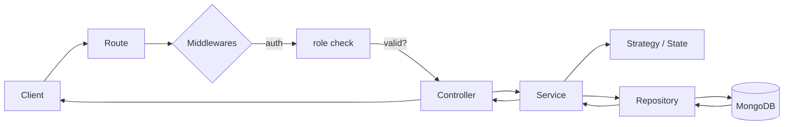
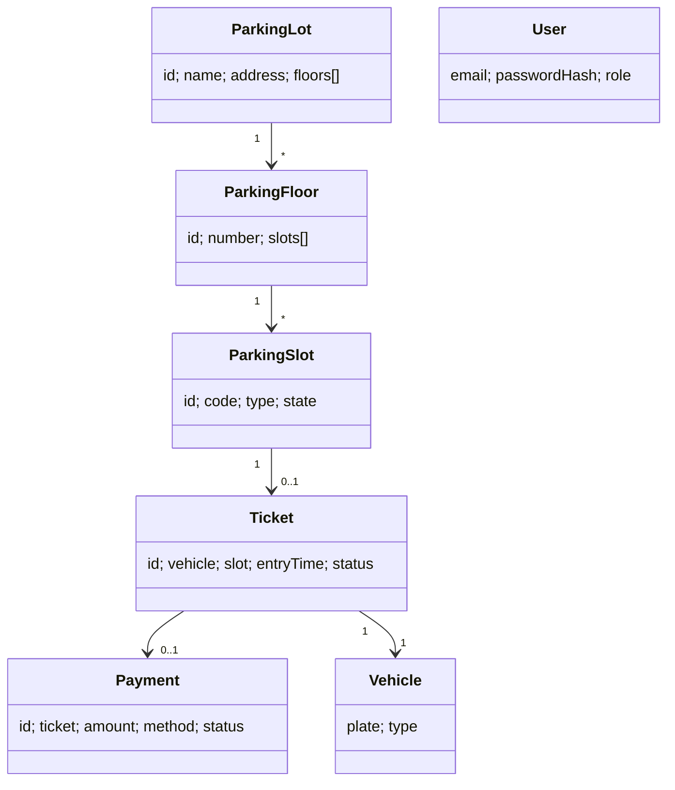
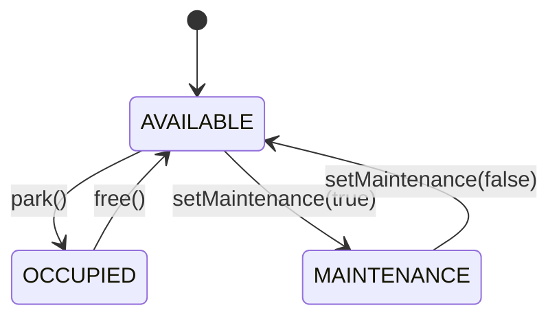
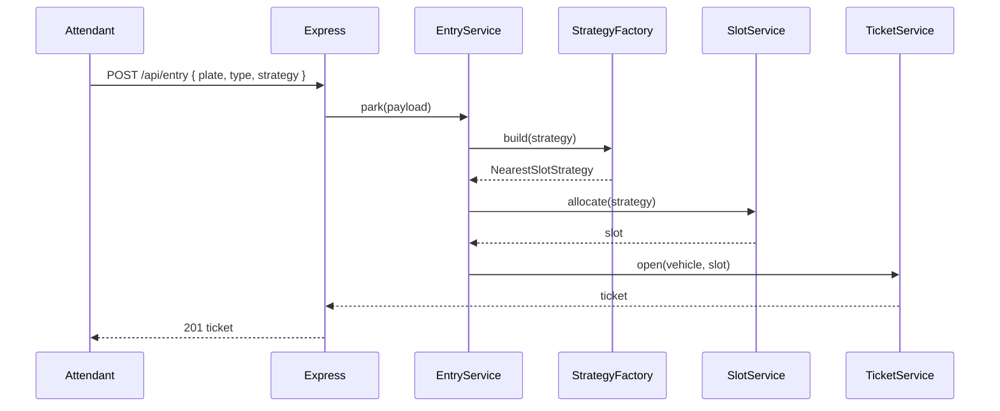
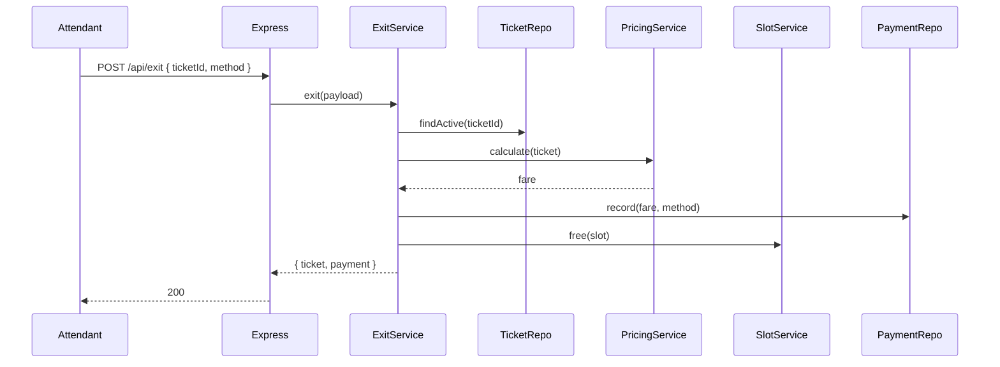

# Parking Lot — Backend

Node.js + Express + MongoDB API for the Parking Lot Management System.
Built with clean layering and the design patterns the LLD asks for.

---

## Run it

```bash
cd backend2
npm install

# .env
# PORT=3000
# MONGODB_URI=mongodb://localhost:27017/parking_lot
# JWT_SECRET=change-me
# JWT_EXPIRES_IN=1d

npm run seed     # optional — seeds an admin + a sample lot
npm run dev      # http://localhost:3000
```

Health check: `GET /health` → `{ ok: true }`

---

## Layering

```
routes/           HTTP shape only — calls a controller
controllers/      Parses req/res — calls a service
services/         Business rules — orchestrates repos + strategies + states
strategies/       Pluggable algorithms (allocation, pricing)
states/           Slot lifecycle (Available / Occupied / Maintenance)
factories/        Build vehicles + strategies from input
repositories/     Mongo access — only place that touches the DB
entities/         Domain objects (Mongoose schemas)
middlewares/      auth, role, validate, error
validators/       Per-route input shape
config/           env + DB connect
```

Each layer depends only on the one below it.
Controllers never touch repositories. Services never touch `req`/`res`.

---

## Patterns at a glance

| Pattern              | Where                                 | Why                              |
| -------------------- | ------------------------------------- | -------------------------------- |
| **Strategy**         | `strategies/allocation`, `pricing`    | Swap slot pick / fare rule       |
| **State**            | `states/slot/*`                       | Slot transitions are state-aware |
| **Factory**          | `factories/StrategyFactory`, `Vehicle`| Build by type, hide construction |
| **Repository**       | `repositories/*`                      | DB stays out of services         |
| **Dependency Inj.**  | `app.js` wires everything             | Easy to test / swap              |
| **Middleware Chain** | `auth → role → validate → handler`    | Cross-cutting concerns           |

---

## Request flow



---

## Domain model



---

## Slot lifecycle (State pattern)



Each state lives in `states/slot/*State.js` and only allows its own legal moves.
Illegal transitions (`park()` on `MAINTENANCE`) throw — services don’t need `if`-ladders.

---

## Entry & exit flows





---

## API surface

| Method | Path                                | Role        | Purpose                |
| ------ | ----------------------------------- | ----------- | ---------------------- |
| POST   | `/api/auth/register`                | public      | Create user            |
| POST   | `/api/auth/login`                   | public      | Get JWT                |
| GET    | `/api/lots`                         | any         | List lots              |
| GET    | `/api/lots/:id`                     | any         | Lot details            |
| GET    | `/api/slots/lot/:lotId`             | any         | Slots in a lot         |
| POST   | `/api/admin/lots`                   | ADMIN       | Create lot             |
| POST   | `/api/admin/slots`                  | ADMIN       | Add slot               |
| PATCH  | `/api/admin/slots/:slotId/maintenance` | ADMIN    | Toggle maintenance     |
| POST   | `/api/entry`                        | ADMIN/ATT.  | Park vehicle, get ticket |
| POST   | `/api/exit`                         | ADMIN/ATT.  | Calculate fare, exit   |

All non-public routes require `Authorization: Bearer <token>`.

---

## Layout

```
src/
├── app.js                  # buildApp() — DI wiring
├── server.js               # boot
├── config/                 # env, db
├── controllers/            # thin HTTP handlers
├── services/               # business logic
├── repositories/           # mongo access
├── entities/               # mongoose schemas
├── enums/                  # roles, statuses, types
├── factories/              # builders
├── strategies/
│   ├── allocation/         # Nearest, FirstAvailable, Random
│   └── pricing/            # Weekday, Weekend, Flat
├── states/slot/            # Available, Occupied, Maintenance
├── middlewares/            # auth, role, validate, error
├── validators/             # input shape per route
└── routes/                 # express routers per resource
```
