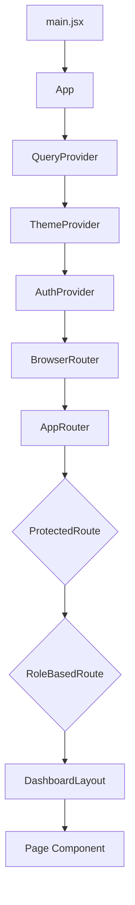
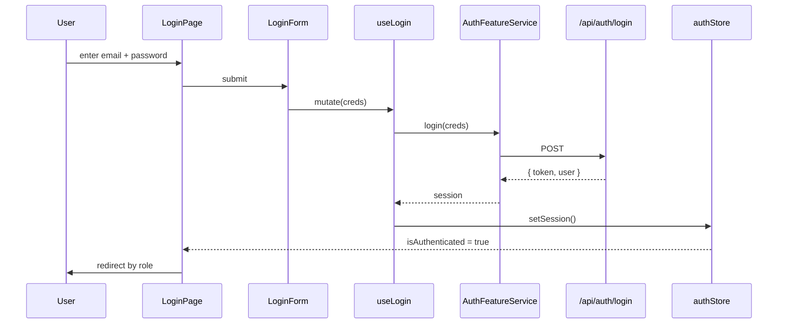
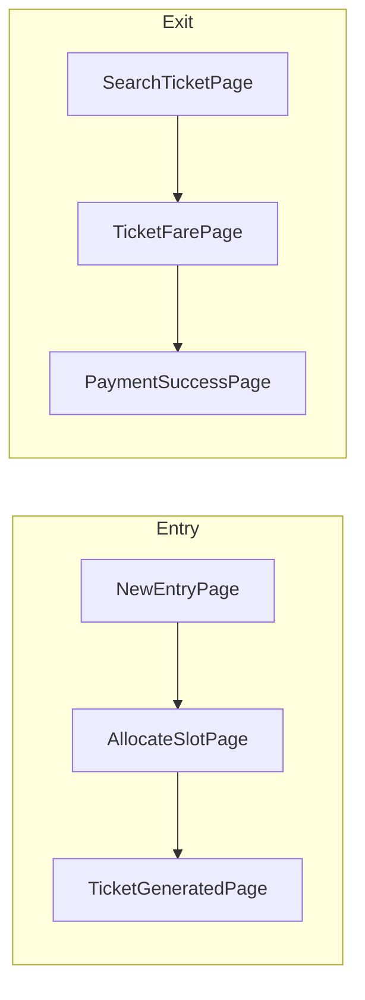
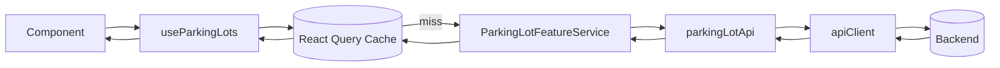

# Parking Lot — Frontend

React 18 + Vite + Tailwind UI for the Parking Lot Management System.
Feature-sliced layout, hooks-first, no over-abstraction.

---

## Run it

```bash
cd frontend2
npm install
npm run dev      # http://localhost:5174
```

The Vite dev server proxies `/api/*` to `http://localhost:3000` — start the backend first.

```bash
npm run build    # production bundle
npm run preview  # serve the build
```

---

## Stack

| Concern        | Choice              | Why                              |
| -------------- | ------------------- | -------------------------------- |
| Framework      | React 18 + Vite     | Fast HMR, ESM-native             |
| Styling        | Tailwind CSS 3      | Utility-first, no CSS files      |
| Routing        | React Router 6      | Nested routes + layouts          |
| Server state   | TanStack Query      | Caching, retries, invalidation   |
| Client state   | Zustand (persisted) | Auth session that survives reloads |
| HTTP           | Axios + interceptors| Auto-attach JWT, auto-logout 401 |

---

## Layering

```
src/
├── app/              # router + providers + global store (composition root)
├── pages/            # route screens — presentation only
├── features/         # domain modules: api / hooks / services / components
├── components/
│   ├── ui/           # design system (Button, Input, Modal, Table, …)
│   ├── layout/       # Sidebar, Header, DashboardLayout, PageContainer
│   └── shared/       # cross-feature cards (Vehicle, Slot, Ticket, Payment)
├── services/         # axios client + raw HTTP services
├── hooks/            # generic hooks (useAuth, useRole, useModal, useDebounce)
├── contexts/         # React contexts (Auth, Theme)
├── constants/        # roles, routes, statuses
├── utils/            # formatters + validators
└── styles/           # tailwind globals + variables
```

**Rules of thumb**

- `pages/` only do layout + wire feature hooks.
- `features/<x>/services/` hold the *business* (mapping, validation, orchestration).
- `services/` do *only* HTTP — one axios instance, one interceptor.
- `components/ui/*` are dumb and variant-driven — no domain knowledge.

---

## Provider tree



---

## Auth flow



Every subsequent request: axios interceptor reads `authStore.token` and adds
`Authorization: Bearer …`. A `401` clears the session.

---

## Entry & exit user flows



State is passed via `react-router` `location.state` — no global store needed for
a 3-step wizard.

---

## Routing & roles

```mermaid
flowchart TB
  Login[/login] --> Guard{Authenticated?}
  Guard -- no --> Login
  Guard -- yes --> Role{Role?}
  Role -- ADMIN --> Admin[/admin/*]
  Role -- ATTENDANT --> Ops[/entry/* /exit/*]
  Admin --> Dash[Dashboard / Lots / Floors / Slots / Users / Pricing / Payments]
  Ops --> Flow[Entry & Exit wizards]
```

`ProtectedRoute` blocks unauth users; `RoleBasedRoute` gates admin pages.
Both live in `src/app/router/`.

---

## Data fetching pattern



A new feature is always 4 small files:

```
features/<name>/
├── api/<name>.api.js              # thin wrapper around services/
├── services/<Name>FeatureService.js  # mapping + business rules
├── hooks/use<Name>.js             # React Query
└── components/<Component>.jsx     # presentation
```

---

## Design system cheatsheet

| Component | File                          | Notes                                |
| --------- | ----------------------------- | ------------------------------------ |
| Button    | `components/ui/Button.jsx`    | `variant`, `size`, `fullWidth`       |
| Input     | `components/ui/Input.jsx`     | `label`, `error`, `hint`             |
| Modal     | `components/ui/Modal.jsx`     | ESC closes, backdrop click closes    |
| Card      | `components/ui/Card.jsx`      | + `CardHeader`                       |
| Table     | `components/ui/Table.jsx`     | column-config driven                 |
| Badge     | `components/ui/Badge.jsx`     | tones: success/danger/warning/brand  |
| Loader    | `components/ui/Loader.jsx`    | spinner with optional label          |

Brand color is `brand.700` (`#6b04fd`) — change `tailwind.config.js` to rebrand.

---

## Where to look first

- New screen? → `src/pages/<area>/<Name>Page.jsx`
- New API call? → `src/features/<x>/api/`
- New shared widget? → `src/components/shared/`
- Auth/session? → `src/app/store/auth.store.js` + interceptor in `src/services/apiClient.js`
- Routes table? → `src/constants/routes.js` (one source of truth)
