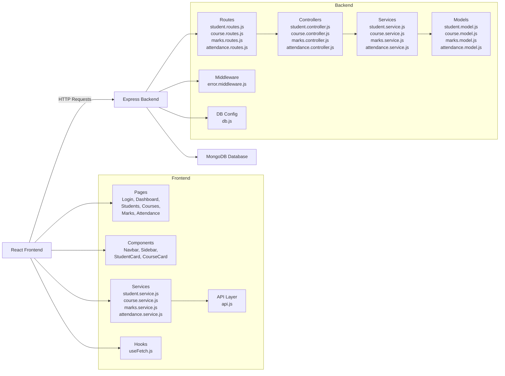
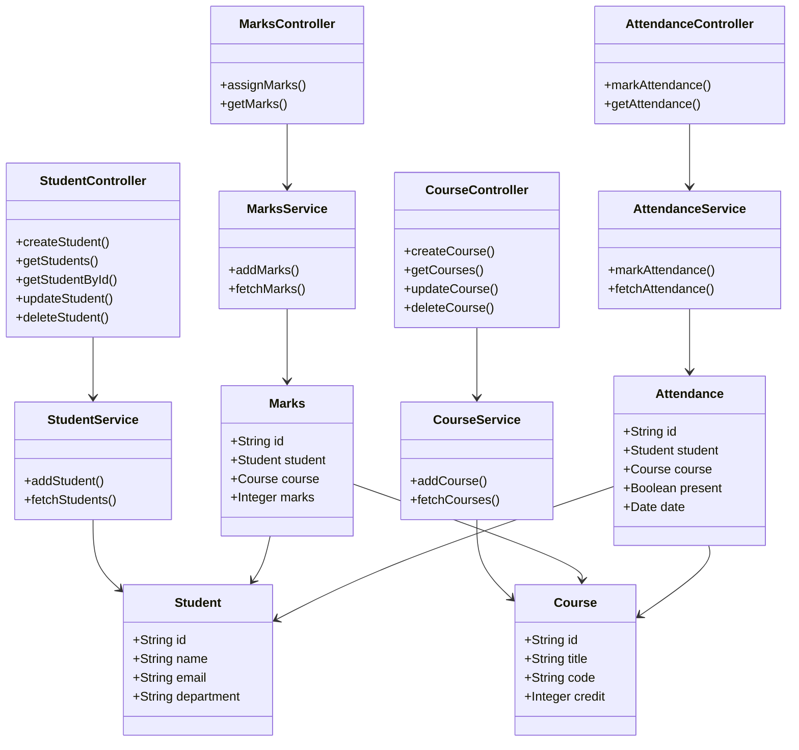
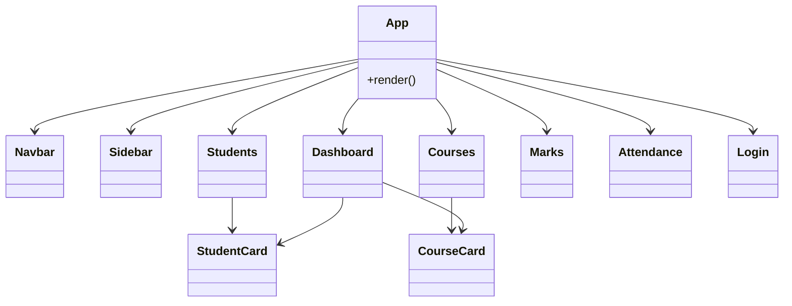

## 🔷 1. System Architecture (Frontend ↔ Backend)



---

## 🔷 2. Backend UML Class Diagram

This shows relationships between your backend layers.



---

## 🔷 3. Frontend Component Structure (Optional)




```code
student-management-frontend/
│
├── public/
│
├── src/
│   ├── main.jsx
│   ├── App.jsx
│
│   ├── components/
│   │   ├── Navbar.jsx
│   │   ├── Sidebar.jsx
│   │   ├── StudentCard.jsx
│   │   ├── CourseCard.jsx
│   │
│   ├── pages/
│   │   ├── Login.jsx
│   │   ├── Dashboard.jsx
│   │   ├── Students.jsx
│   │   ├── Courses.jsx
│   │   ├── Marks.jsx
│   │   └── Attendance.jsx
│
│   ├── services/
│   │   ├── api.js
│   │   ├── student.service.js
│   │   ├── course.service.js
│   │   ├── marks.service.js
│   │   └── attendance.service.js
│
│   ├── styles/
│   │   └── app.css
│
│   └── hooks/
│       └── useFetch.js
│
└── package.json


student-management-backend/
│
├── src/
│   ├── server.js
│   ├── app.js
│
│   ├── config/
│   │   └── db.js
│
│   ├── models/
│   │   ├── student.model.js
│   │   ├── course.model.js
│   │   ├── marks.model.js
│   │   └── attendance.model.js
│
│   ├── controllers/
│   │   ├── student.controller.js
│   │   ├── course.controller.js
│   │   ├── marks.controller.js
│   │   └── attendance.controller.js
│
│   ├── services/
│   │   ├── student.service.js
│   │   ├── course.service.js
│   │   ├── marks.service.js
│   │   └── attendance.service.js
│
│   ├── routes/
│   │   ├── student.routes.js
│   │   ├── course.routes.js
│   │   ├── marks.routes.js
│   │   └── attendance.routes.js
│
│   └── middlewares/
│       └── error.middleware.js
│
├── .env
├── package.json hi give me UML language using best mermaid diagram , but correct syntax  