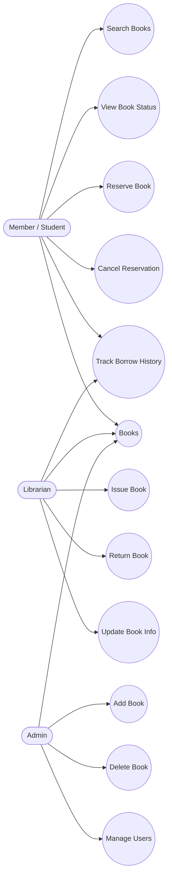
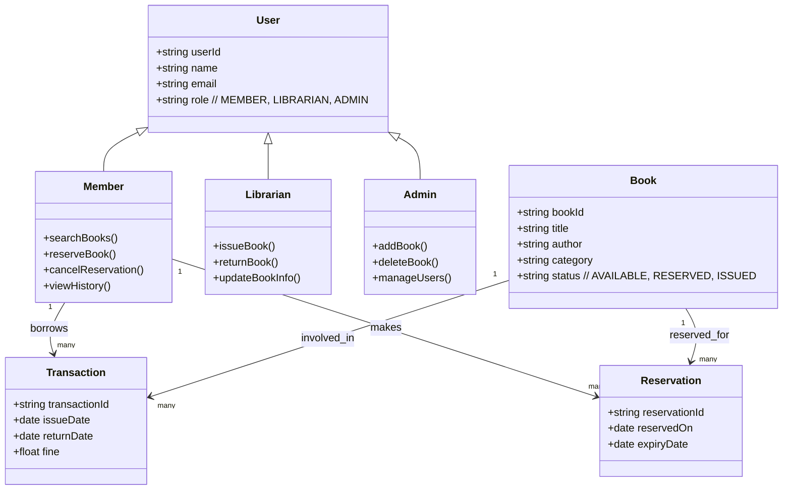
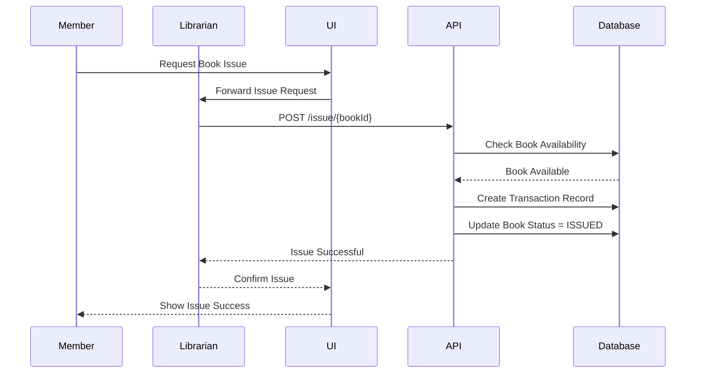
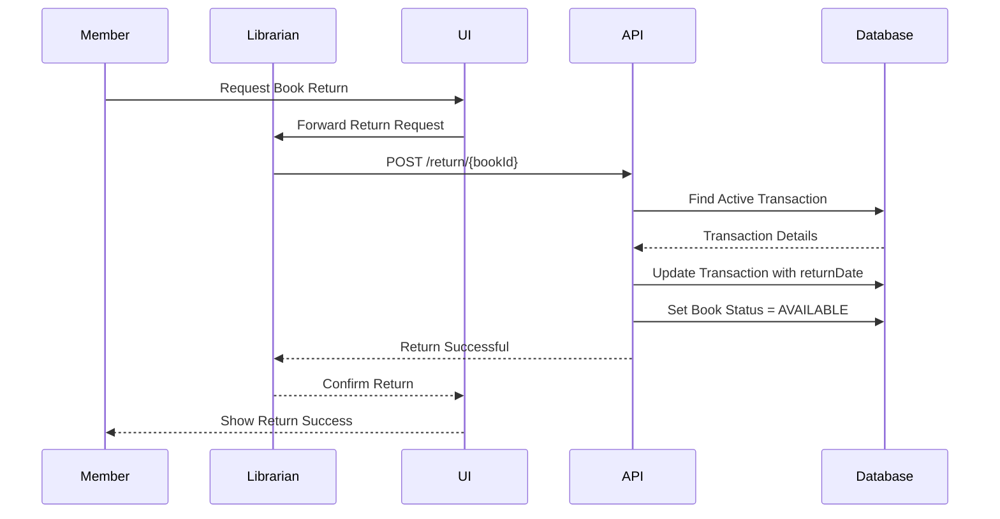
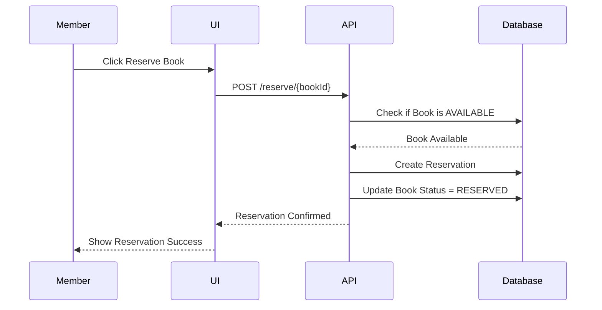
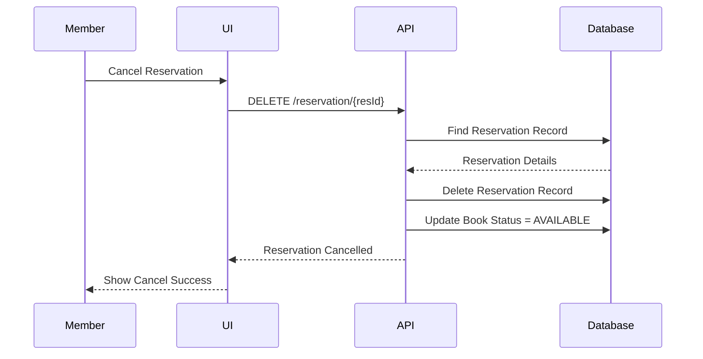
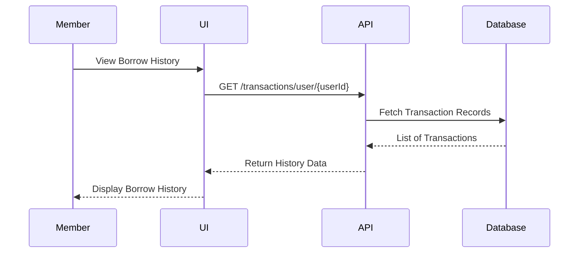

Great! Here is a **clean, accurate, strictly valid Mermaid Use Case Diagram** for the **Library Management System** covering:

✔ Issue books
✔ Return books
✔ Reserve books
✔ Track books
✔ Admin & Librarian roles
✔ Student/Member actions

---

# 📌 **Library Management System – Use Case Diagram (Mermaid)**



---


Absolutely! Based on the **Use Case Diagram** you approved for the Library Management System, here are the **best possible Class Diagram and ER Diagram**—both strictly valid Mermaid syntax and aligned with your real system functionalities: **Issue → Return → Reserve → Track**.

---

# 📘 **1️⃣ CLASS DIAGRAM (UML) – Library Management System**

This class diagram models the actual system behavior from use cases:
✔ Issue
✔ Return
✔ Reserve
✔ Cancel Reservation
✔ Track history
✔ Manage books
✔ Manage users



---

# ✔ Why This Class Diagram Is Correct

Matches the use case diagram perfectly:

| Use Case             | Class Responsible             |
| -------------------- | ----------------------------- |
| Issue Book           | Librarian → Transaction, Book |
| Return Book          | Librarian → Transaction, Book |
| Reserve Book         | Member → Reservation, Book    |
| Cancel Reservation   | Member → Reservation          |
| Track Borrow History | Member → Transaction          |
| Add/Update Book      | Librarian/Admin → Book        |
| Manage Users         | Admin → User                  |

---

# 📘 **2️⃣ ER DIAGRAM – Library Management System**

This captures the actual database structure needed to support all functionalities.

```mermaid
erDiagram

    USERS {
        string _id PK
        string name
        string email
        string role
    }

    BOOKS {
        string _id PK
        string title
        string author
        string category
        string status  // AVAILABLE, RESERVED, ISSUED
    }

    TRANSACTIONS {
        string _id PK
        string user_id FK
        string book_id FK
        date issue_date
        date return_date
        float fine
    }

    RESERVATIONS {
        string _id PK
        string user_id FK
        string book_id FK
        date reserved_on
        date expiry_date
    }

    USERS ||--o{ TRANSACTIONS : performs
    BOOKS ||--o{ TRANSACTIONS : contains

    USERS ||--o{ RESERVATIONS : reserves
    BOOKS ||--o{ RESERVATIONS : reserved_for
```

---

## ✔ Why This ER Diagram Is Perfect

It supports:

| Feature       | ER Relationship                |
| ------------- | ------------------------------ |
| Issue/Return  | TRANSACTIONS links USER ↔ BOOK |
| Reservation   | RESERVATIONS links USER ↔ BOOK |
| Track History | Query TRANSACTIONS by user     |
| Manage Books  | BOOKS table                    |
| Manage Users  | USERS table                    |

---

# 🎯 Your Next Step (Choose One)

What do you want next?

3️⃣ **Sequence diagrams** (Issue, Return, Reserve flows)
4️⃣ **CRUD + Component architecture diagrams**
5️⃣ **Node.js + MongoDB backend boilerplate**
6️⃣ **Frontend React architecture diagrams**

Reply with **3, 4, 5, or 6** 🚀


Absolutely — here are the **clean, precise, strictly valid Mermaid sequence diagrams** for the **core use cases** of the Library Management System:

✔ Issue Book
✔ Return Book
✔ Reserve Book
✔ Cancel Reservation
✔ Track Borrow History

All diagrams follow the exact actors and flows defined in your Use Case Diagram.

---

# 📘 **1️⃣ Sequence Diagram – Issue Book**



---

# 📘 **2️⃣ Sequence Diagram – Return Book**



---

# 📘 **3️⃣ Sequence Diagram – Reserve Book**



---

# 📘 **4️⃣ Sequence Diagram – Cancel Reservation**



---

# 📘 **5️⃣ Sequence Diagram – Track Borrow History**



---

# ✔ These Diagrams Align Perfectly With Your Use Cases

| Use Case             | Sequence Diagram Provided |
| -------------------- | ------------------------- |
| Issue Book           | ✅ Yes                     |
| Return Book          | ✅ Yes                     |
| Reserve Book         | ✅ Yes                     |
| Cancel Reservation   | ✅ Yes                     |
| Track Borrow History | ✅ Yes                     |

---

# 🎯 What's next?

Would you like:

6️⃣ **CRUD + Component architecture diagrams**
7️⃣ **Backend Node.js + MongoDB boilerplate** (models, controllers, services, routes)
8️⃣ **Frontend React diagrams**

Reply with **6, 7, or 8** 🚀
