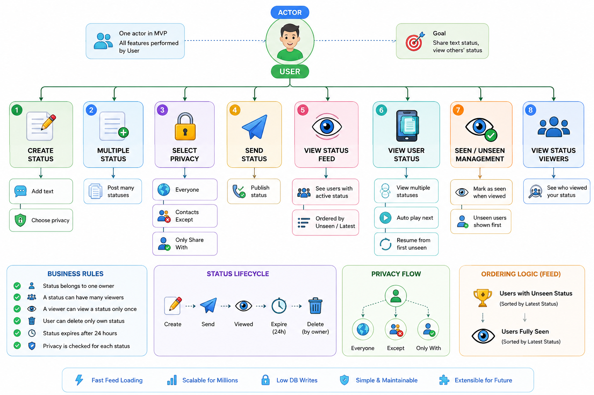
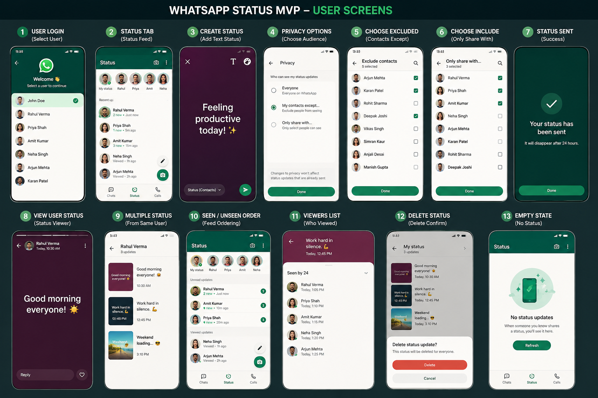

Hey buddy 😄. This is actually a very good MVP because WhatsApp Status seems simple, but there are lots of hidden design decisions.

Let's design it as if we are Meta engineers, but keep it MVP.

Step 1: Functional Requirements
User
Login as a user (for MVP simply click user)
Put text status
Delete own status
View others' status
View multiple statuses from same user
See viewers of my status
Privacy
Everyone
My Contacts Except...
Only Share With...
Step 2: Main Entities
User
------
id
name

Status
------
id
userId
text
createdAt
expiresAt (24 hrs)

StatusView
-----------
statusId
viewerId
viewedAt

StatusPrivacy
--------------
statusId
type
excludedUserIds[]
includedUserIds[]

Notice

We don't update Status itself when someone views.

Instead

Status

is immutable.

Views go into

StatusView

This is much cleaner.

Step 3: Home Screen

Imagine there are

A (Current User)

Friends

B
C
D
E
F
G
H
I
J

Each friend may have

B

Status1
Status2
Status3

C

Status1

D

Status1
Status2

...

UI doesn't show every status.

It shows

B
C
D
E

Only person list.

Why?

Because WhatsApp groups statuses by owner.

Step 4: Backend Query

When opening Status page

Instead of

Return all statuses

Return

Grouped by User

Example

[
  {
    user:B,
    statuses:[
      S1,
      S2,
      S3
    ]
  },
  {
    user:C,
    statuses:[
      S4
    ]
  }
]
Step 5: Ordering People

This is the interesting part.

Suppose

B
3 statuses

C
5 statuses

D
2 statuses

Current user

Already watched

B

Status1
Status2

Not watched

Status3

Current UI should still show

B

as

Unseen

because one remains.

Suppose

C

Viewed all

Then

C

moves to bottom.

So ordering rule becomes

All users having at least one unseen status

↓

Sorted by latest unseen status time

↓

All users fully seen

↓

Sorted by latest seen status time

Exactly how WhatsApp behaves.

Example

Current User A

B

S1 Seen
S2 Seen
S3 Unseen

Latest = 10AM

----------------

C

S1 Seen

Latest=11AM

----------------

D

S1 Unseen

Latest=9AM

Display

B
D

--------

C

Why?

Because

B

still has unseen.

D

also unseen.

C

fully watched.

Step 6: Opening One Person

Click

B

Backend returns

[
S1
S2
S3
]

Ordered

createdAt ASC

because story plays oldest → newest.

User watches

S1

Insert

StatusView

status=S1
viewer=A

Then

S2

Another insert

No updates.

Only inserts.

Step 7: What if User Stops at 3rd Status?

Suppose

B

S1
S2
S3
S4
S5

Current user watches

S1
S2
S3

Leaves app.

Database

Views

S1 ✓
S2 ✓
S3 ✓

Next opening

Backend computes

Seen

3

Remaining

2

Resume from

S4

Easy.

Step 8: How Resume Works

Find first unseen.

SQL-like idea

Statuses

LEFT JOIN StatusView

Return

[
Seen
Seen
Seen
Unseen
Unseen
]

Frontend starts from first unseen.

Step 9: Viewing Screen
B

----------------

Status1 ✓

Status2 ✓

Status3 Playing

Status4

Status5
Step 10: How Creator Sees Viewers

Owner

B

opens

Status2

Query

StatusView

WHERE

statusId=S2

Join User

Result

John

Rahul

David

Alex
Step 11: Privacy Check

Whenever fetching statuses

Filter

Status belongs to

Everyone

OR

Current user included

AND

Current user not excluded

Only eligible statuses are returned.

Step 12: Backend Flow
Home Opens

↓

Get Friends

↓

Get Active Statuses
(expiry > now)

↓

Apply Privacy

↓

Group By User

↓

Compute

seenCount

unseenCount

latestStatus

↓

Sort

↓

Return
Step 13: Response to Frontend
[
  {
    "user": {
      "id": 2,
      "name": "Rahul"
    },
    "unseenCount": 2,
    "seenCount": 3,
    "latestStatusAt": "10:20",
    "statuses": [
      {
        "id": 11,
        "seen": true
      },
      {
        "id": 12,
        "seen": true
      },
      {
        "id": 13,
        "seen": true
      },
      {
        "id": 14,
        "seen": false
      },
      {
        "id": 15,
        "seen": false
      }
    ]
  }
]

Frontend already knows:

where to resume (first seen: false)
whether to show the user in the Unseen or Seen section
how many status items remain.
Step 14: A Better Mental Model

Instead of thinking:

Status List

think in two levels.

Status Feed
│
├── User B
│     ├── Status 1
│     ├── Status 2
│     └── Status 3
│
├── User C
│     └── Status 1
│
├── User D
│     ├── Status 1
│     └── Status 2
│
└── User E
      └── Status 1

The home screen is a list of users, not a list of status items. When a user is selected, you drill down into that user's ordered sequence of statuses.

For your MVP

To keep it focused, I'd implement only these APIs:

POST /status → Create a text status.
GET /status/feed → Return grouped statuses for the current user after applying privacy, along with seen/unseen metadata.
GET /status/:userId → Return that user's active statuses in chronological order.
POST /status/:statusId/view → Record a view (idempotent so duplicate requests don't create duplicate records).
GET /status/:statusId/viewers → Return viewers for the owner only.
DELETE /status/:statusId → Delete your own status.

This design is simple, scalable, and closely matches how a real-world status system behaves while remaining an excellent MVP for learning system design.

Buddy, this is exactly the right way to learn LLD.

One thing I want to slightly correct first:

LLD != Database Design

LLD is about classes, services, responsibilities, APIs, interactions, SOLID, design patterns, extensibility.

Database design is only one small part.

Since you said MERN, let's think like a backend engineer at Meta designing an MVP that could eventually scale.

Step 1. Think about Scale First

Suppose

Users
1 Billion

Average friends
800

Average statuses/day
2

Status lifetime
24 hrs

Daily statuses

2 Billion statuses/day

Now ask yourself

Can I query

SELECT *
FROM Status
WHERE ...

Obviously impossible.

So we need another strategy.

Step 2. Collections

Instead of creating many collections

Keep only

users

friendships

statuses

statusViews

Notice

No

statusFeed
statusOrder
statusSeen

Keep MVP simple.

Users
{
   _id,
   name,
   avatar
}
Friendships
{
   _id,
   userId,
   friendId
}

Simple.

Status
{
   _id,

   ownerId,

   text,

   privacy,

   includeUsers:[],

   excludeUsers:[],

   createdAt,

   expiresAt
}
StatusView
{
    statusId,

    viewerId,

    viewedAt
}

That's all.

Four collections.

Step 3. Why don't we store
seen=true

inside Status?

Imagine

1 status

5 million viewers

If we keep

viewers:[...]

inside Status

Every view updates same document.

Mongo becomes hotspot.

Instead

Status

unchanged

Insert

StatusView

Much faster.

Step 4. Login

For MVP

GET

/users

Returns

Rahul

Amit

John

David

Click

Rahul

Store

currentUserId

Done.

No authentication.

Step 5. Creating Status

User types

Hello Everyone

Chooses

Everyone

Insert

Status

Nothing else.

Step 6. Hard Part

Opening Feed

Suppose

Current User

A

Friends

B

C

D

E

Each has

Thousands

statuses.

Do we query

Status

WHERE ownerId=B

Status

WHERE ownerId=C

Status

WHERE ownerId=D

800 queries?

No.

Instead

First

Friend list

[B,C,D,E]

Now

One query

ownerId

IN

[
B,
C,
D,
E
]

Mongo handles

$in

beautifully.

Step 7. But Billions Users?

Notice

We're NOT searching billion users.

We're searching

Current Friend List

≈800 ids

Huge difference.

The query becomes

Statuses

WHERE

ownerId

IN friendIds

AND

expiresAt > now

Only friends.

Not everyone.

Step 8. Privacy

Suppose

Everyone

Return.

Suppose

Exclude

John

Skip.

Suppose

Only Share

David

Alex

Return only those.

Privacy filtering happens after fetching candidate statuses (or can be partly encoded into the query for simple cases). In the MVP, readability is more important than squeezing every microsecond out of the query.

Step 9. Grouping

Database returns

S1

Owner=B

S2

Owner=D

S3

Owner=B

S4

Owner=C

S5

Owner=D

Group

B

S1

S3

--------

C

S4

--------

D

S2

S5
Step 10. Seen

Need to know

Current User

A

has seen what.

Fetch

StatusView

viewer=A

Suppose

S1

S2

seen.

Now

B

S1 Seen

S3 Unseen

--------

C

S4 Unseen

--------

D

S2 Seen

S5 Unseen
Step 11. Ordering

Now compute

B

has unseen

latest

10AM

------------

C

has unseen

latest

9AM

------------

D

has unseen

latest

11AM

Order

D

B

C

If

B

All seen

Move

B

to bottom.

Algorithm

Partition

↓

Unseen

↓

Seen

↓

Sort each group

Simple.

Step 12. Why Not Store Feed?

Many beginners think

Feed Collection

Imagine

1 status

800 friends

Need

800 inserts.

Delete after 24 hrs.

Update when viewed.

Terrible for an MVP.

Instead

Generate the feed dynamically when the user opens the status screen.

Step 13. Indexes

This is where scale starts.

Status

ownerId

createdAt

expiresAt

Compound index

(ownerId, expiresAt)

Very useful.

StatusView

viewerId

statusId

Compound

(viewerId,statusId)

Lets us answer

Seen?

in milliseconds.

Friendship

userId

Index.

Fetch friends quickly.

Step 14. Service Layer (LLD)

Your LLD should naturally separate responsibilities instead of putting everything into one controller.

StatusController
        │
        ▼
StatusService
        │
 ┌──────┼──────────┐
 ▼      ▼          ▼
FriendService PrivacyService ViewService
        │          │
        ▼          ▼
 FriendRepo   StatusRepo

Each service has one responsibility:

FriendService → Who are my friends?
PrivacyService → Can this viewer see this status?
ViewService → Has the viewer already seen this status?
StatusService → Orchestrates everything and builds the final feed.
Step 15. How a Feed Request Flows
User opens Status page
        │
        ▼
StatusController
        │
        ▼
StatusService
        │
        ├── FriendService → Get friend IDs
        │
        ├── StatusRepository → Get active statuses for those friends
        │
        ├── PrivacyService → Remove statuses not visible
        │
        ├── ViewService → Mark seen/unseen
        │
        ├── Group by owner
        │
        ├── Partition into unseen/seen
        │
        ├── Sort by latest status
        │
        ▼
Return feed to React

Notice that every class has a clear job, which makes the code easier to test and extend.

A note about billions of users

The key insight is this:

Your feed query never scans all users.

If the platform has 2 billion users, but you only have 1,000 friends, your query only needs to consider those 1,000 friend IDs. With proper indexes, the database jumps directly to the relevant status documents instead of scanning the entire collection.

This is one of the biggest mindset shifts in scalable system design:

Design queries around the user's neighborhood (friends/following), not around the entire database.

What I recommend next

Don't jump into coding yet.

For learning LLD, the next step should be designing:

Folder structure
Classes
Interfaces
Repositories
Services
DTOs
Sequence diagrams
Design patterns used (Repository, Strategy for privacy, Factory if needed)

That exercise will teach you much more about LLD than writing Express routes immediately.

Buddy, I actually love the way you're approaching this.

You're following the same process many senior engineers use.

Before writing a single class, they spend time in the Requirements Phase.

For learning LLD, I recommend following this sequence every single time:

1. Requirements
2. Actors
3. Use Cases
4. Constraints
5. Domain Model
6. Class Design
7. Design Patterns
8. APIs
9. Database
10. Implementation

Notice that database comes much later. Many beginners start with MongoDB schemas, but LLD starts with understanding the domain.

Step 1: Identify Actors

For an MVP, ask:

"Who can perform actions in this system?"

For WhatsApp Status MVP, there is actually only one actor.

Actor

User

Every logged-in person is simply a User.

No need for Admin, Moderator, Analytics, etc.

Keep it simple.

Step 2: What can the User do?

Now brainstorm every possible action.

Don't think about code.

Think about user behavior.

Status

✓ Create text status

✓ Delete own status

✓ View friends' statuses

✓ View multiple statuses of one friend

✓ Resume from first unseen status

✓ View viewers of own status

✓ Select privacy

✓ See seen/unseen ordering

Already we have the MVP.

Step 3: What should NOT be in MVP?

This is even more important.

For LLD learning, removing unnecessary features helps you focus.

Don't include:

❌ Images

❌ Videos

❌ GIFs

❌ Voice status

❌ Emoji reactions

❌ Reply to status

❌ Forward status

❌ Mention

❌ Background music

❌ Search

❌ Archive

❌ Pin

❌ Mute

❌ Analytics

❌ Notifications

❌ Encryption

Your goal isn't to clone WhatsApp—it's to practice designing clean software.

Step 4: Use Cases

Now convert operations into use cases.

User

↓

Create Status

↓

Delete Status

↓

View Feed

↓

Open User Status

↓

View Next Status

↓

View Previous Status

↓

See Status Viewers

↓

Choose Privacy

Each of these will eventually become one or more service methods.

Step 5: Functional Requirements

Now write requirements clearly.

FR-1

User can create a text status.

FR-2

A user can create multiple statuses.

FR-3

Each status expires after 24 hours.

(No need to discuss how yet.)

FR-4

User can delete their own status.

FR-5

User can view statuses shared with them.

FR-6

Statuses from the same user appear as a sequence.

FR-7

Viewing one status marks only that status as viewed.

FR-8

User resumes from the first unseen status.

FR-9

Status owner can view who has seen each status.

FR-10

Privacy options:

Everyone

Contacts Except

Only Share With
FR-11

Users with at least one unseen status appear before users whose statuses are fully viewed.

FR-12

Within each group, users are ordered by the latest active status.

Step 6: Non-Functional Requirements

For an MVP, keep only the important ones.

Fast feed loading

Scalable

Simple architecture

Maintainable

Extensible

Low database writes

Support millions of users later

Don't spend time on things like disaster recovery, geo-replication, or caching yet. Those belong more to HLD than your current LLD goal.

Step 7: Business Rules

These are often forgotten, but they're valuable because they drive your design.

Examples:

A status belongs to exactly one owner.

A status can have multiple viewers.

A viewer can view a status only once
(from a business perspective).

A user cannot delete another user's status.

Expired statuses are invisible.

A user can own multiple active statuses.

Privacy is evaluated separately for every status.

These rules naturally guide your class responsibilities later.

Step 8: Domain Objects (Don't Think About Classes Yet)

Notice I didn't say "classes."

Instead ask:

"What are the real-world things in this system?"

User

Status

StatusView

Privacy

That's enough.

Don't invent:

StatusFeed

StatusManager

StatusTracker

StatusBuilder

StatusCache

Those may become services later, but they're not domain concepts.

Step 9: Questions a Senior Engineer Would Ask

Before writing code, they often clarify things like:

Can a user create unlimited statuses?
Can two statuses have the same timestamp?
What happens if a status expires while someone is viewing it?
Can a user change the privacy after posting?
Should opening a status automatically mark it as viewed, or only after it's displayed?
If only some statuses from a user are viewed, where should that user appear in the feed?

Even if your MVP answers these simply, asking these questions helps you discover edge cases before coding.

My recommendation for learning LLD

For every project (WhatsApp Status, Gmail, Uber, YouTube, etc.), use the same checklist:

1. Actors
2. Use Cases
3. Functional Requirements
4. Non-Functional Requirements
5. Business Rules
6. Domain Objects
7. Sequence Diagrams
8. Class Diagram
9. Design Patterns
10. Folder Structure
11. APIs
12. Database
13. Code

If you consistently follow this order, you'll build a strong LLD foundation. More importantly, you'll learn to think like a designer first and a coder second, which is the mindset interviewers look for in LLD discussions.

Good now can you generate the image which showing the flow of the software like which actor have the which operation simply and easy to explain based on the above with minimal text but rich icons for all above operations looking good color ful icon rich

Good awsome now can you generate the image having the screens for actor  user   covering all above actions please with preimum ui and professional simple modern and modern whatsapp look so I will take this as refernce for creating MVP UI 

sngle file within only a tree structure with file names and function names with , for the backend for MERN socket io  (node , mongo db ) using best SOLID principles and module based architecture - don't over complicate , keep minimal but best standards as you said maintain Strategy , State , Factory , Repository , Observer(Pub/Sub) , Repo , service , singleton where it needs so give me backend tree structure best standard ways please 

Buddy, since your goal is learning LLD, I would not design it the way many tutorials do (controllers with 500-line service files).

Instead, let's build it like a production-ready backend while still keeping the MVP small.

Design Principles
✅ Module-based architecture
✅ SOLID
✅ Repository Pattern
✅ Service Layer
✅ Strategy Pattern (Privacy)
✅ State Pattern (Status Visibility)
✅ Factory Pattern (Socket Events)
✅ Observer / Pub-Sub (Socket.io)
✅ Singleton (Mongo, Socket, Config)
✅ Simple dependency direction
❌ No unnecessary abstraction
❌ No CQRS
❌ No Event Sourcing
❌ No Microservices
Backend Tree Structure (MERN + Socket.io)
backend/
│
├── src/
│
├── app.js                                  → createExpressApp()
├── server.js                               → startServer()
│
├── config/
│   ├── database.js                         → connectMongo()                     [Singleton]
│   ├── socket.js                           → createSocketServer()              [Singleton]
│   └── env.js                              → loadEnvironment()
│
├── modules/
│
│   ├── user/
│   │
│   │   ├── user.routes.js                  → registerUserRoutes()
│   │   ├── user.controller.js              → login()
│   │   ├── user.service.js                 → loginUser()
│   │   ├── user.repository.js              → findAll()
│   │   ├── user.model.js
│   │   └── user.mapper.js                  → toUserResponse()
│   │
│   ├── friendship/
│   │
│   │   ├── friendship.service.js           → getFriendIds()
│   │   ├── friendship.repository.js        → findFriends()
│   │   └── friendship.model.js
│   │
│   ├── status/
│   │
│   │   ├── status.routes.js
│   │   │      registerStatusRoutes()
│   │   │
│   │   ├── status.controller.js
│   │   │      createStatus()
│   │   │      getFeed()
│   │   │      getUserStatuses()
│   │   │      deleteStatus()
│   │   │      getViewers()
│   │   │
│   │   ├── status.service.js
│   │   │      createStatus()
│   │   │      buildFeed()
│   │   │      getStatuses()
│   │   │      removeStatus()
│   │   │      getStatusViewers()
│   │   │
│   │   ├── status.repository.js
│   │   │      create()
│   │   │      findActiveStatuses()
│   │   │      findByOwner()
│   │   │      delete()
│   │   │      findById()
│   │   │
│   │   ├── status.model.js
│   │   │
│   │   ├── status.mapper.js
│   │   │      toFeedResponse()
│   │   │      toStatusResponse()
│   │   │
│   │   ├── status.validator.js
│   │   │      validateCreateStatus()
│   │   │
│   │   └── status.constants.js
│   │
│   ├── privacy/
│   │
│   │   ├── privacy.service.js
│   │   │      canViewStatus()
│   │   │
│   │   ├── strategies/
│   │   │
│   │   │      privacy.strategy.js
│   │   │           canView()
│   │   │
│   │   │      everyone.strategy.js
│   │   │           canView()
│   │   │
│   │   │      exclude.strategy.js
│   │   │           canView()
│   │   │
│   │   │      onlyShare.strategy.js
│   │   │           canView()
│   │   │
│   │   └── privacy.factory.js
│   │          createStrategy()             [Factory]
│   │
│   ├── view/
│   │
│   │   ├── view.routes.js
│   │   │      registerViewRoutes()
│   │   │
│   │   ├── view.controller.js
│   │   │      markViewed()
│   │   │
│   │   ├── view.service.js
│   │   │      markViewed()
│   │   │      getSeenMap()
│   │   │
│   │   ├── view.repository.js
│   │   │      create()
│   │   │      exists()
│   │   │      findViewerStatuses()
│   │   │
│   │   └── view.model.js
│
├── core/
│
│   ├── feed/
│   │
│   │   ├── feed.service.js
│   │   │      buildFeed()
│   │   │      groupStatuses()
│   │   │      sortFeed()
│   │   │
│   │   ├── ordering.service.js
│   │   │      orderUsers()
│   │   │
│   │   ├── resume.service.js
│   │   │      findResumeStatus()
│   │   │
│   │   └── states/
│   │
│   │          unseen.state.js
│   │               priority()
│   │
│   │          seen.state.js
│   │               priority()
│   │
│   │          state.factory.js
│   │               createState()           [State]
│   │
│   ├── socket/
│   │
│   │   ├── socket.gateway.js
│   │   │      registerEvents()
│   │   │
│   │   ├── socket.publisher.js
│   │   │      publishStatusCreated()
│   │   │      publishStatusViewed()
│   │   │      publishStatusDeleted()
│   │   │
│   │   ├── socket.subscriber.js
│   │   │      subscribeStatusEvents()
│   │   │
│   │   ├── socket.factory.js
│   │   │      createEvent()                [Factory]
│   │   │
│   │   └── socket.events.js
│   │
│   ├── repositories/
│   │
│   │   └── base.repository.js
│   │          create()
│   │          update()
│   │          delete()
│   │          findById()
│   │
│   ├── middleware/
│   │
│   │      error.middleware.js
│   │           handleError()
│   │
│   │      request.middleware.js
│   │           attachCurrentUser()
│   │
│   ├── utils/
│   │
│   │      date.util.js
│   │           isExpired()
│   │           now()
│   │
│   │      id.util.js
│   │           generateId()
│   │
│   └── constants/
│   │
│   │      privacy.constants.js
│   │      socket.constants.js
│   │
│   └── errors/
│          app.error.js
│          notFound.error.js
│          validation.error.js
│
└── package.json
Design Patterns Used
Pattern	Where Used	Responsibility
Repository	*.repository.js	Isolates MongoDB queries from business logic
Service	*.service.js	Contains business rules and orchestration
Strategy	privacy/strategies/	Different privacy behaviors (Everyone, Exclude, Only Share With)
Factory	privacy.factory.js, socket.factory.js, state.factory.js	Creates the correct strategy, socket event, or state object
State	core/feed/states/	Encapsulates feed ordering behavior for Seen vs Unseen users
Observer (Pub/Sub)	socket.publisher.js + socket.subscriber.js	Broadcasts status creation, deletion, and views through Socket.IO
Singleton	database.js, socket.js, env.js	Ensures a single MongoDB connection, Socket.IO instance, and configuration
One recommendation

For LLD interviews (Amazon, Microsoft, Google, Walmart, etc.), this is about the maximum architecture I'd recommend for an MVP. It demonstrates:

Proper separation of concerns.
Practical use of common design patterns.
Clean, testable modules.
Easy extensibility (for adding image/video statuses later) without introducing unnecessary complexity.

This structure is realistic enough to resemble a production codebase while remaining compact enough to understand and implement end-to-end as a learning project.

Good now come to the frontend so you created so many screens for the frontend so for that also I want tree structure in the single file covering all the screens of each actor like above give me folder , file name / function name -- don't over complicate , make simple but follow SOLID principles and use design patterns if needed MERN stack i.e REACT give me tree structure  

Buddy, for LLD, the frontend should also follow the same principles.

Most React projects become messy because everything is inside components/ and pages/.

For learning LLD, think like this:

UI (Screens)
        ↓
Hooks (UI Logic)
        ↓
Services (API Calls)
        ↓
Socket Layer
        ↓
Backend

The UI should never know Axios or Socket.io.

React Frontend Tree Structure (MERN + Socket.io)
frontend/
│
├── src/
│
├── main.jsx                                → bootstrapApplication()
├── App.jsx                                 → renderApplication()
│
├── app/
│   ├── router.jsx                          → createRouter()
│   ├── providers.jsx                       → registerProviders()
│   └── routes.js                           → registerRoutes()
│
├── assets/
│
├── layouts/
│   ├── AppLayout.jsx                       → renderLayout()
│   └── EmptyLayout.jsx                     → renderEmptyLayout()
│
├── modules/
│
│   ├── auth/
│   │
│   │   ├── pages/
│   │   │      UserLoginPage.jsx            → UserLoginPage()
│   │   │
│   │   ├── components/
│   │   │      UserList.jsx                 → UserList()
│   │   │      UserCard.jsx                 → UserCard()
│   │   │
│   │   ├── hooks/
│   │   │      useLogin.js                  → useLogin()
│   │   │
│   │   ├── services/
│   │   │      auth.api.js                  → login()
│   │   │
│   │   └── context/
│   │          AuthProvider.jsx             → AuthProvider()
│   │
│   ├── status/
│   │
│   │   ├── pages/
│   │   │
│   │   │      StatusFeedPage.jsx           → StatusFeedPage()
│   │   │
│   │   │      CreateStatusPage.jsx         → CreateStatusPage()
│   │   │
│   │   │      StatusViewerPage.jsx         → StatusViewerPage()
│   │   │
│   │   │      StatusViewersPage.jsx        → StatusViewersPage()
│   │   │
│   │   │      MyStatusesPage.jsx           → MyStatusesPage()
│   │   │
│   │   ├── components/
│   │   │
│   │   │      FeedList.jsx                 → FeedList()
│   │   │
│   │   │      FeedItem.jsx                 → FeedItem()
│   │   │
│   │   │      StoryProgressBar.jsx         → StoryProgressBar()
│   │   │
│   │   │      StatusCard.jsx               → StatusCard()
│   │   │
│   │   │      StatusComposer.jsx           → StatusComposer()
│   │   │
│   │   │      StatusTextEditor.jsx         → StatusTextEditor()
│   │   │
│   │   │      StatusPrivacySelector.jsx    → StatusPrivacySelector()
│   │   │
│   │   │      PrivacyUserSelector.jsx      → PrivacyUserSelector()
│   │   │
│   │   │      ViewerList.jsx               → ViewerList()
│   │   │
│   │   │      ViewerItem.jsx               → ViewerItem()
│   │   │
│   │   │      DeleteStatusDialog.jsx       → DeleteStatusDialog()
│   │   │
│   │   │      EmptyStatus.jsx              → EmptyStatus()
│   │   │
│   │   ├── hooks/
│   │   │
│   │   │      useStatusFeed.js             → useStatusFeed()
│   │   │
│   │   │      useCreateStatus.js           → useCreateStatus()
│   │   │
│   │   │      useStatusViewer.js           → useStatusViewer()
│   │   │
│   │   │      useViewers.js                → useViewers()
│   │   │
│   │   │      useMyStatuses.js             → useMyStatuses()
│   │   │
│   │   ├── services/
│   │   │
│   │   │      status.api.js                → createStatus()
│   │   │                                     getFeed()
│   │   │                                     getStatuses()
│   │   │                                     deleteStatus()
│   │   │                                     getViewers()
│   │   │
│   │   ├── state/
│   │   │
│   │   │      StatusProvider.jsx           → StatusProvider()
│   │   │
│   │   │      status.reducer.js            → statusReducer()
│   │   │
│   │   │      status.actions.js            → createStatusAction()
│   │   │                                     feedLoadedAction()
│   │   │                                     viewedAction()
│   │   │
│   │   └── mappers/
│   │          status.mapper.js             → toFeedModel()
│   │                                         toViewerModel()
│   │
│   └── friendship/
│       │
│       ├── services/
│       │      friendship.api.js            → getFriends()
│       │
│       └── hooks/
│              useFriends.js                → useFriends()
│
├── core/
│
│   ├── api/
│   │
│   │      axios.js                         → createHttpClient()          [Singleton]
│   │
│   ├── socket/
│   │
│   │      socket.js                        → createSocket()              [Singleton]
│   │
│   │      socket.events.js                 → registerSocketEvents()
│   │
│   │      socket.publisher.js              → emit()
│   │
│   │      socket.subscriber.js             → subscribe()
│   │
│   ├── router/
│   │
│   │      navigation.js                    → navigate()
│   │
│   ├── hooks/
│   │
│   │      useApi.js                        → useApi()
│   │
│   │      useSocket.js                     → useSocket()
│   │
│   │      useDialog.js                     → useDialog()
│   │
│   ├── components/
│   │
│   │      Button.jsx                       → Button()
│   │
│   │      Avatar.jsx                       → Avatar()
│   │
│   │      Loader.jsx                       → Loader()
│   │
│   │      EmptyState.jsx                   → EmptyState()
│   │
│   │      SearchBox.jsx                    → SearchBox()
│   │
│   │      Modal.jsx                        → Modal()
│   │
│   │      PageHeader.jsx                   → PageHeader()
│   │
│   │      FloatingButton.jsx               → FloatingButton()
│   │
│   ├── utils/
│   │
│   │      date.util.js                     → formatTime()
│   │                                         isExpired()
│   │
│   │      feed.util.js                     → orderFeed()
│   │                                         groupFeed()
│   │
│   ├── constants/
│   │
│   │      privacy.constants.js
│   │
│   │      routes.constants.js
│   │
│   │      socket.constants.js
│   │
│   └── styles/
│          globals.css
│
└── package.json
Screens Covered
1. User Login

2. Status Feed

3. Create Status

4. Privacy Selection

5. Contacts Except

6. Only Share With

7. My Status

8. Status Viewer

9. Viewers List

10. Delete Status Dialog

11. Empty Status

These are exactly the screens required for your MVP.

Design Patterns Used
Pattern	Frontend Usage
Container–Presentational	Pages orchestrate; Components only render UI
Custom Hooks	Encapsulate UI/business logic (useStatusFeed, useCreateStatus, etc.)
Service Layer	All HTTP communication in *.api.js; components never call Axios directly
Provider (Dependency Injection)	AuthProvider, StatusProvider share state without prop drilling
Reducer (State Pattern)	status.reducer.js manages predictable UI state transitions
Observer (Pub/Sub)	socket.subscriber.js listens for real-time updates; socket.publisher.js emits events
Singleton	Single Axios instance and single Socket.IO client
Mapper	Converts backend DTOs into UI-friendly models before rendering
Folder Dependency Rule (Very Important)

To keep the architecture clean, dependencies should flow in one direction only:

Pages
   ↓
Components
   ↓
Hooks
   ↓
Services
   ↓
Axios / Socket
   ↓
Backend
Pages compose screens.
Components render reusable UI and receive data via props.
Hooks contain presentation logic and state management.
Services perform API and Socket.IO communication.
Core contains shared infrastructure used by all modules.

This keeps your React codebase modular, testable, and aligned with SOLID principles without introducing unnecessary complexity.